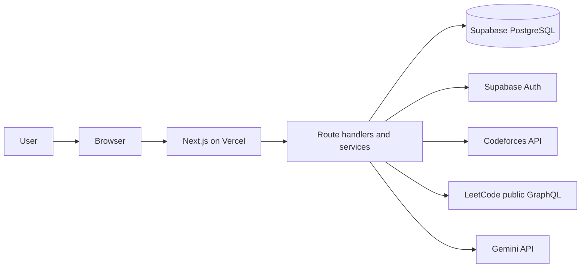

# AlgoGym

AlgoGym is a competitive programming workspace for connected coding profiles, structured practice, intelligent learning, progress analytics, and college programming communities. [Open the live application](https://algogym.vercel.app/).

## Why AlgoGym exists

Coding progress is fragmented across providers, practice often lacks a sequence, and college societies have few shared measures of progress. AlgoGym connects supported public profiles, organizes practice into tracks, shows provider-specific statistics, and offers Symm AI learning paths. Rewards use provider evidence rather than self-reported activity.

## Features

| Area | Implemented behavior |
| --- | --- |
| Coding profiles | Ownership challenges for Codeforces, LeetCode, CodeChef, AtCoder, GitHub, and GeeksforGeeks. Data depth differs by provider. |
| Training Gym | Codeforces problem catalog, curated tracks, timed sessions, and restored local session state. |
| Symm AI | Gemini-backed curriculum, saved modules and lessons, C++/Java/Python code variants, contextual tutor, and practice recommendations. **Learn competitive programming from first principles.** Requires a Gemini key. |
| Rewards | Verified Codeforces solves feed a versioned Chakra ledger, shown as coins in parts of the UI. LeetCode individual solve awards are disabled. Competitive module bonuses also require a new verified eligible solve. |
| Statistics | Codeforces rating and submission history; public LeetCode aggregates where available. |
| Communities | College search, societies, applications, memberships, invitations, and management roles. |
| Leaderboards | Individual, society, and college scopes with metric-specific database rankings. |

See [integration coverage](docs/integrations.md) and [reward rules](docs/chakra.md) for precise limitations.

## Technology and architecture

| Layer | Technology | Responsibility |
| --- | --- | --- |
| Web | Next.js 16 App Router, React 19, TypeScript | Routes, rendering, API dispatch |
| Styling | Tailwind CSS 3, Radix-based UI | Design system and controls |
| Identity and data | Supabase Auth and PostgreSQL | Sessions, records, row-level security |
| AI | Server-side Gemini API | Curriculum, lessons, code variants, tutor |
| Hosting | Vercel | Next.js deployment and daily sync trigger |



Provider sync and Symm AI jobs are stored in PostgreSQL and executed from Next.js requests or a Vercel cron invocation. Redis, a dedicated worker service, and a second authentication system are **not deployed**. See [architecture](docs/architecture.md).

## Repository map

```text
src/app/               Next.js pages, layouts, API dispatch
src/features/          Symm AI and Training Gym screens
src/screens/           Other product screens
src/components/        Shared layout, brand, and UI components
src/hooks/, src/lib/    Hooks and domain helpers
src/proxy.ts            Supabase session refresh
server/api-handlers/   Validated business endpoints
server/next-api/       Next.js request adapters
server/               Provider, AI, and job services
supabase/migrations/   Ordered PostgreSQL schema history
supabase/functions/    Profile verification Edge Function
scripts/               Explicit development and diagnostic tools
docs/                  Engineering reference
assets/                Design references used by ui-ux.md
public/                Runtime assets and licensed fonts
```

`src/app/api/[...path]/route.ts` preserves existing `/api/*` URLs through a dispatch table. Older root product and design documents remain historical references; `/docs` contains the current engineering description.

## Local development

Use Node.js 22.12 or newer and npm, then:

```sh
git clone https://github.com/Symmetry7/AlgoGym.git
cd AlgoGym
npm ci
```

Copy `.env.example` to `.env.local` and supply credentials from a **development** Supabase project. Apply `supabase/migrations/` in order to that project; for a linked development project, the Supabase CLI command is `supabase db push`. Configure the Supabase Google provider and allow `http://localhost:8080/api/auth/callback` for local OAuth testing. Do not reset production data.

```sh
npm run dev
```

Open <http://localhost:8080>. The landing page is `/`; authenticated navigation starts at `/dashboard`. Symm AI generation needs `GEMINI_API_KEY`.

### Environment variables

| Name | Purpose |
| --- | --- |
| `SUPABASE_URL`, `SUPABASE_PUBLISHABLE_KEY` | Project URL and publishable key for auth requests |
| `SUPABASE_SERVICE_ROLE_KEY` | Server-only privileged database calls |
| `APP_ORIGIN` | Canonical origin for redirects and request validation |
| `CRON_SECRET` | Bearer secret for `/api/jobs/sync` |
| `GEMINI_API_KEY` | Server-only Symm AI credential |
| `GEMINI_MODEL` | Optional model override |

The server also accepts `NEXT_PUBLIC_SUPABASE_*` and historical `VITE_SUPABASE_*` fallbacks; new setups should use `.env.example`. Never expose privileged keys through a public prefix. See [deployment](docs/deployment.md).

## Data, identity, and security

Supabase migrations define profiles, colleges, societies, provider sync and submission records, problems, learning paths, and the reward ledger. Row-level security protects private records; server handlers validate the current user and ownership before privileged access. Google OAuth uses Supabase PKCE; email/password, confirmation, recovery, and sign-out are implemented. Session cookies are refreshed by `src/proxy.ts`. See [database](docs/database.md), [authentication](docs/authentication.md), and [API](docs/api.md).

Codeforces provides public submission and contest history. LeetCode provides public profile aggregates but no individual accepted-submission evidence suitable for current rewards. Other connected providers focus on ownership and public metadata. See [integrations](docs/integrations.md).

Symm AI plans the roadmap first, persists lesson outlines, and generates details or language variants on demand. Its database jobs can be recovered by request execution or the cron path. Reading a lesson does not itself award coins. See [Symm AI](docs/symm-ai.md) and [Chakra](docs/chakra.md).

## Commands

| Command | Purpose |
| --- | --- |
| `npm run dev` | Development server on port 8080 |
| `npm run typecheck` | TypeScript check |
| `npm test` | Vitest suite; live tests are opt-in |
| `npm run build` | Production build |
| `npm run start` | Serve production build on port 8080 |
| `npm run format.fix` | Format with Prettier |

There is currently no lint script or CI workflow. Browser and SQL integration scripts under `scripts/` have separate requirements; inspect them before use against any database.

## Deployment and limitations

`vercel.json` selects Next.js and schedules `/api/jobs/sync` daily. Deployment needs server secrets, migrations, Auth redirect configuration, and an authorized cron request. Job throughput is limited by serverless execution time and the schedule. Gemini and provider availability affect generation and synchronization; no throughput benchmark is asserted here. See [deployment](docs/deployment.md).

## Contributing and license

Read [contributing](docs/contributing.md), branch from the current main branch, keep changes focused, and run the available checks before a pull request. No license file is present; no open-source license is implied.
