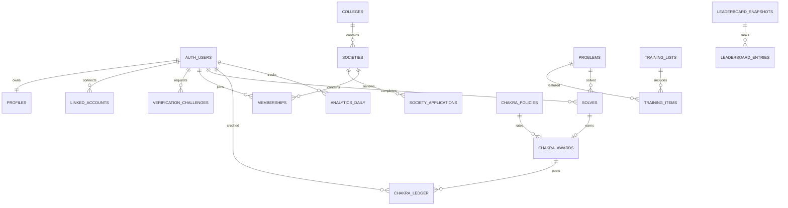

# AlgoGym 2.0 — API & Database Design

**Version:** 1.0 · **Date:** 17 October 2026  
**Companion documents:** `prd.md`, `architecture.md`  
**Target stack:** Next.js App Router + TypeScript + **Supabase** (Database, Auth, Storage, RLS) + managed background workers  
**Status:** Implementation blueprint; review against the existing Supabase project before applying migrations.

## 1. Architectural decision

**Supabase is the database and backend data platform.** Supabase Database runs PostgreSQL under the hood; these are *not* competing choices. This design specifies Supabase products rather than a separately hosted PostgreSQL server:

| Concern | Target |
|---|---|
| Application | Next.js App Router on Vercel |
| Identity | Supabase Auth, Google OAuth; `@supabase/ssr` cookie-backed sessions |
| Data | Supabase Database (managed PostgreSQL) |
| Authorization | Supabase Row Level Security (RLS) + server-side authorization |
| Files | Supabase Storage, private evidence and public approved media buckets |
| Realtime | Optional Supabase Realtime for user-visible progress/status, not scoring authority |
| Background data sync | Durable queue/worker, using Supabase-backed queue where supported or equivalent |
| Recurring orchestration | Scheduled invocations (e.g., Supabase Cron/managed scheduler), idempotent jobs |
| API | Next.js Route Handlers/Server Actions plus restricted Supabase Data API |
| Analytics | Derived Supabase tables and precomputed leaderboard snapshots |

Do not create a second auth service, separate PostgreSQL deployment, or unnecessary microservices. **Do not run destructive migrations on the existing production Supabase project.** First inventory tables, auth.users identities, RLS, storage, current scoring and sync behavior; create a backed-up migration plan.

## 2. Contracts and invariants

1. Google login proves AlgoGym identity, *not* Codeforces or LeetCode ownership.
2. Verification tokens are server-generated, short-lived (10 minutes), single-use, hashed at rest, and bound to `(user_id, provider, normalized_handle)`.
3. Each user has **at most one active competitive society membership**; colleges may have multiple societies.
4. Every problem has a canonical `(provider, external_problem_id)` identifier.
5. A user earns **one initial Chakra award per canonical provider problem**, only after a verified eligible accepted solve; repeat solves earn zero.
6. Award inserts, ledger credit, and outbox event must commit atomically or not at all.
7. Ledger events are append-only. Corrections use compensating entries; never silently edit points.
8. Codeforces Chakra awards use the rating bracket through **3500**; LeetCode is **Easy=15, Medium=45, Hard=110**.
9. **LeetCode Chakra is feature-gated OFF** until individual accepted solves can be verified reliably and compliantly; publicly displayed aggregate totals alone cannot prove eligible solves.
10. Ratings remain provider-specific. Do not average Codeforces and LeetCode contest ratings into an invented universal rating.
11. Society competition must be normalized, disclose eligible-member rules, and prevent cross-society double counting.
12. Historical affiliation is effective-dated; scoring never retroactively assigns past solves to a newly joined society without an explicit policy.
13. UI balances, ranks and progress are derived from authoritative server-side records, not user-supplied numbers.

## 3. Data ownership & schema conventions

- `auth.users` is owned by Supabase Auth; use `auth.users(id)` as identity FK. Never manually edit `auth.users`.
- Application tables live in `public` with RLS; internal queues, integration secrets and job-only raw payloads belong in a non-exposed `internal` schema or secured server services.
- Primary keys are UUIDs. Timestamps use `timestamptz` UTC. Use `created_at`, `updated_at`, and `deleted_at` only where appropriate.
- Identifiers/handles store original display text plus a normalized comparable value.
- App roles belong in membership/admin tables, **not user-editable JWT metadata**.
- Personally identifying verification evidence, email addresses, operational logs and provider raw submissions are private by default.
- Public profile aggregates are explicitly whitelisted fields, ideally served from dedicated read models.
- Use `ON DELETE RESTRICT` for audit-critical records; deletion and anonymization require a documented account-removal workflow.

## 4. Entity relationship overview



## 5. Supabase tables and constraints

### Identity and colleges

| Table | Key fields | Constraints / notes |
|---|---|---|
| `profiles` | `id uuid PK references auth.users(id)`, `display_name`, `avatar_url`, `onboarding_status`, `created_at` | User editable own non-privileged fields only |
| `platform_admins` | `user_id PK`, `granted_by`, `granted_at`, `revoked_at` | Privileged management only; not client writable |
| `colleges` | `id PK`, `slug`, `name`, `normalized_name`, `city`, `state`, `status` | Unique `slug`; alias table for name matching |
| `college_aliases` | `college_id`, `normalized_alias` | Unique alias globally after adjudication |
| `societies` | `id PK`, `college_id FK`, `name`, `slug`, `description`, `status`, `created_by`, `logo_path`, `approved_at` | Unique `(college_id, slug)`; pending/approved/rejected/suspended |
| `society_applications` | `id`, `society_id`, `applicant_id`, `evidence_path`, `status`, `decided_by`, `reason` | Evidence private and reviewed only by platform admin |
| `memberships` | `id`, `user_id`, `society_id`, `role`, `status`, `competitive`, `effective_from`, `effective_to`, `reviewed_by` | Partial unique index for one current competitive membership; historical rows retained |
| `membership_requests` | `id`, `user_id`, `society_id`, `status`, `created_at`, `decided_at`, `decided_by` | Prevent concurrent duplicate pending requests |

Membership roles: `member`, `moderator`, `admin`. Membership statuses: `pending`, `active`, `rejected`, `left`, `suspended`. Use DB CHECK constraints or explicit enums, document enum migrations.

**Uniqueness:** `CREATE UNIQUE INDEX one_active_competitive_membership ON public.memberships(user_id) WHERE status = 'active' AND competitive = true AND effective_to IS NULL;`

Consider a transfer transaction that closes the previous membership before activating the next, with a configurable cooldown; do not update affiliations outside the transaction.

### Linked coding platforms and sync

| Table | Key fields | Constraints / notes |
|---|---|---|
| `linked_accounts` | `id`, `user_id`, `provider`, `external_user_id`, `handle`, `handle_normalized`, `verified_at`, `status`, `last_synced_at` | Unique `(provider, external_user_id)` where provider stable ID exists; otherwise unique `(provider, handle_normalized)` with handle-change reconciliation |
| `verification_challenges` | `id`, `user_id`, `provider`, `requested_handle`, `token_hash`, `expires_at`, `attempt_count`, `consumed_at`, `status` | Never expose token hash; enforce bounded attempts |
| `sync_runs` | `id`, `linked_account_id`, `job_type`, `status`, `started_at`, `finished_at`, `cursor`, `error_code` | Concurrency controls and redacted errors |
| `provider_submissions` | `id`, `linked_account_id`, `provider_submission_id`, `problem_id`, `verdict`, `submitted_at`, `fetched_at` | Unique `(provider, provider_submission_id)`; job-only writes; optional retention cap |
| `provider_rating_history` | `linked_account_id`, `contest_id`, `contest_at`, `rating_before`, `rating_after` | Unique `(linked_account_id, contest_id)` |
| `provider_sync_cursors` | `linked_account_id`, `stream`, `cursor`, `last_success_at` | Durable incremental checkpoint |

Keep LeetCode provider methods behind a pluggable connector with explicit capability flags: `profile_read`, `ownership_check`, `accepted_submission_evidence`, `rating_history`. A connector that lacks the third capability cannot issue Chakra awards.

### Training, accepted solves, Chakra ledger

| Table | Key fields | Constraints / notes |
|---|---|---|
| `problems` | `id`, `provider`, `external_problem_id`, `url`, `cf_rating`, `lc_difficulty`, `tags`, `active` | Unique `(provider, external_problem_id)`; provider-specific difficulty CHECK |
| `training_lists` | `id`, `title`, `description`, `visibility`, `created_by` | Reuse existing training entities when possible |
| `training_items` | `id`, `training_list_id`, `problem_id`, `position` | Unique `(training_list_id, problem_id)` |
| `solves` | `id`, `user_id`, `problem_id`, `linked_account_id`, `first_accepted_at`, `proof_submission_id`, `proof_status` | Unique `(user_id, problem_id)`; must be independently verified |
| `chakra_policies` | `id`, `version`, `effective_at`, `cf_brackets jsonb`, `lc_difficulty_points jsonb`, `status`, `approved_by` | Immutable once active; only one active policy per effective window |
| `chakra_awards` | `id`, `user_id`, `problem_id`, `solve_id`, `policy_id`, `difficulty_snapshot`, `points`, `awarded_at` | Unique `(user_id, problem_id)`; awards immutable |
| `chakra_ledger` | `id`, `user_id`, `award_id`, `entry_type`, `delta`, `reason`, `created_at`, `actor_id` | Append-only; unique grant for each award; reversal may require approval |
| `outbox_events` | `id`, `event_type`, `aggregate_id`, `payload`, `occurred_at`, `processed_at` | Created in same transaction as award |
| `chakra_balance_cache` | `user_id`, `balance`, `refreshed_at` | Derived only; rebuildable from ledger |

**Never award Chakra merely because a client calls an API with `solved=true`, or because a user checked a training checkbox.** A training interaction can request a sync; only provider evidence confirms a solve.

### Statistics and leaderboards

| Table | Key fields | Constraints / notes |
|---|---|---|
| `analytics_daily` | `user_id`, `provider`, `date`, `solves_count`, `chakra_earned`, `difficulty_breakdown`, `topic_breakdown`, `updated_at` | Unique `(user_id, provider, date)`; worker owned |
| `society_analytics_daily` | `society_id`, `date`, `eligible_members`, `active_members`, `solves`, `chakra`, `updated_at` | Effective-dated membership |
| `leaderboard_snapshots` | `id`, `scope`, `metric`, `period_start`, `period_end`, `policy_version`, `computed_at`, `generation` | Stable snapshot metadata |
| `leaderboard_entries` | `snapshot_id`, `subject_type`, `subject_id`, `rank`, `score`, `eligible_count`, `secondary_sort` | Unique `(snapshot_id, subject_type, subject_id)`; indexed rank |
| `audit_logs` | `id`, `actor_id`, `action`, `object_type`, `object_id`, `metadata`, `created_at` | Restrict read access and retention |
| `job_locks` | `job_key`, `locked_until`, `attempts` | Optional if queue service already provides leasing |

**Public statistics** should exclude direct email, evidence files, challenge tokens, internal sync traces and unapproved memberships.

## 6. Canonical Chakra policy v1

### Codeforces

| Problem rating | Chakra awarded |
|---|---:|
| 800–999 | 10 |
| 1000–1199 | 15 |
| 1200–1399 | 25 |
| 1400–1599 | 40 |
| 1600–1799 | 60 |
| 1800–1999 | 85 |
| 2000–2199 | 115 |
| 2200–2399 | 150 |
| 2400–2599 | 190 |
| 2600–2799 | 240 |
| 2800–2999 | 300 |
| 3000–3199 | 375 |
| 3200–3399 | 475 |
| 3400–3500 | **600** |

For Codeforces problems below 800, above 3500, or without a valid rating: `0` Chakra under v1 unless an explicitly versioned future policy decides otherwise. Use problem rating, **not** user rating.

### LeetCode

| Difficulty | Chakra |
|---|---:|
| Easy | 15 |
| Medium | 45 |
| Hard | 110 |

LeetCode points must remain **disabled** until the backend can prove accepted solves with an approved connector. Ownership verification and a public count of solved problems are insufficient.

**Rule:** difficulty/points are frozen in each award's snapshot at the time of award. Rating reclassification never silently recalculates old credits. A Codeforces+LeetCode combined balance sums legitimately awarded events across both; equivalent-looking problems on different platforms are distinct canonical problems unless policy explicitly defines deduplication across providers.

## 7. Atomic award algorithm

```text
worker receives verified accepted provider submission
  -> validate owning linked account is verified
  -> canonicalize provider problem ID
  -> validate solve is eligible under versioned policy
  -> begin database transaction
      INSERT provider_submissions ON CONFLICT DO NOTHING
      INSERT solves(user_id, problem_id, ...) ON CONFLICT DO NOTHING
      if solve newly inserted and eligible:
          INSERT chakra_awards ON CONFLICT DO NOTHING
          if award inserted:
              INSERT chakra_ledger(type='grant', delta=points)
              INSERT outbox_events(type='chakra.awarded')
  -> commit
  -> asynchronously refresh balance / analytics / leaderboards
```

Implement as a narrowly authorized, transaction-safe database function callable **only by a trusted worker** or a controlled server transaction with explicit privilege checks; not as three independent client requests. Prevent negative grants, reject zero/invalid snapshots, and enforce immutable audit rows. Use constraint-based idempotency and transaction retries for transient conflicts.

## 8. Leaderboard specifications

**Metrics (separate leaderboards):**
- `codeforces_rating`: latest verified Codeforces rating; tie-break max rating, then stable user ID.
- `codeforces_solved`: distinct verified Codeforces problems solved.
- `leetcode_solved`: distinct verifiable LeetCode solved problems where capability supports it.
- `chakra`: current earned Chakra after approved reversals, optionally scoped to last 7/30 days, semester, all-time.
- `college_chakra`, `society_chakra`: normalized performance views, *not raw total points of all members*.

**Fairness:** baseline V1 society score = average eligible member Chakra earned in the selected period, with a minimum eligible roster size configured by platform admins (proposed 5) and minimum recent activity threshold; show raw total as a secondary informational metric. Additional metrics: per-member median, active-member percentage, member count, sample size and last computed time. For colleges, deduplicate student contribution across their societies and aggregate across eligible students only. Publish exact numerator/denominator, eligibility and ranking policy in UI.

**Windows:** `7d`, `30d`, `semester` (calendar/configured), `all`. For period rankings, count only eligible events occurring during that period **and during relevant active membership intervals**. Historical personal Chakra always stays with user through society transfers.

**Snapshot:** worker computes a consistent generation, inserts full snapshot+entries in a transaction, and atomically marks it published. API reads most recent published generation and exposes `computedAt` and `isStale`.

## 9. API conventions

- Public web read routes under `/api/v1`; mutations require Supabase-authenticated cookie session and CSRF/origin safeguards for cookie-based requests.
- JSON uses camelCase; ISO-8601 UTC timestamps; pagination via `cursor` and `limit` (max 100); filters explicitly allowlisted.
- On every mutation, verify the authenticated user with Supabase Auth server-side. `userId` from client payload is ignored for ownership checks.
- API may use Supabase Data API for RLS-safe reads. All privileged scoring, approval, role changes and job orchestration go through protected Next.js handlers/worker services.
- Provide request IDs. Apply IP+user rate limiting to verification, joining and provider sync.
- Consistent error envelope:

```json
{
  "error": {
    "code": "VERIFICATION_EXPIRED",
    "message": "The verification code has expired.",
    "requestId": "req_example"
  }
}
```

**Status mapping:** `400` invalid input, `401` authentication required, `403` forbidden, `404` unknown resource, `409` state conflict/duplicate membership, `422` unsupported provider verification, `429` throttled, `502/503` provider or worker unavailable.

## 10. API endpoint catalog

### Auth and profiles

| Method | Path | Access | Purpose |
|---|---|---|---|
| `GET` | `/auth/callback` | OAuth callback | Exchange code and establish Supabase session (framework route) |
| `GET` | `/api/v1/me` | User | Own profile, verification and onboarding |
| `PATCH` | `/api/v1/me` | User | Update allowed display fields |
| `GET` | `/api/v1/users/{id}` | Public | Public coding identity/profile |
| `GET` | `/api/v1/users/{id}/statistics` | Public/private by visibility | Aggregated analytics |

### Account linking

| Method | Path | Access | Purpose |
|---|---|---|---|
| `POST` | `/api/v1/linked-accounts/challenges` | User | Create short-lived ownership challenge |
| `POST` | `/api/v1/linked-accounts/challenges/{id}/verify` | User | Validate external profile field |
| `GET` | `/api/v1/linked-accounts` | User | List own connected accounts |
| `DELETE` | `/api/v1/linked-accounts/{id}` | Owner | Unlink with historical-award retention policy |
| `POST` | `/api/v1/linked-accounts/{id}/sync` | Owner | Enqueue rate-limited refresh; never immediate award claim |

**Create challenge request:**
```json
{"provider":"codeforces","handle":"tourist"}
```
**Response (201):**
```json
{
  "challengeId": "uuid",
  "verificationCode": "VERIFY-CF-EXAMPLE",
  "expiresAt": "2026-10-17T12:10:00Z",
  "profileField": "firstName",
  "instructionsUrl": "https://codeforces.com/settings/social"
}
```
The challenge code is returned exactly once and stored only as a digest server-side. Example field/URL is provisional and must be smoke-tested against live platform UI. LeetCode `summary` must be tested for public retrieval and change propagation before shipping.

### College / society management

| Method | Path | Access | Purpose |
|---|---|---|---|
| `GET` | `/api/v1/colleges` | Public | Search normalized colleges |
| `GET` | `/api/v1/colleges/{id}` | Public | College page and approved societies |
| `GET` | `/api/v1/societies` | Public | Approved societies search |
| `POST` | `/api/v1/society-applications` | User | Submit society registration with evidence reference |
| `GET` | `/api/v1/societies/{slug}` | Public | Approved public details |
| `PATCH` | `/api/v1/societies/{id}` | Society admin | Update allowlisted profile fields |
| `POST` | `/api/v1/societies/{id}/join-requests` | User | Apply to join |
| `GET` | `/api/v1/societies/{id}/join-requests` | Society staff | Pending join requests |
| `POST` | `/api/v1/societies/{id}/join-requests/{requestId}/decision` | Society staff | Approve/reject |
| `GET` | `/api/v1/societies/{id}/members` | Public/staff filtered | Member roster |
| `POST` | `/api/v1/societies/{id}/members/{userId}/leave` | Owner/authorized admin | Close active membership |
| `GET` | `/api/v1/societies/{id}/statistics` | Public/staff filtered | Aggregate society analytics |

### Training, Chakra, analytics, leaderboards

| Method | Path | Access | Purpose |
|---|---|---|---|
| `GET` | `/api/v1/training/lists` | Public/user | Available training lists |
| `GET` | `/api/v1/training/lists/{id}` | Public/user | Problem list and own statuses |
| `GET` | `/api/v1/problems` | Public | Search/filter catalog |
| `GET` | `/api/v1/me/solves` | User | Verified personal solves |
| `GET` | `/api/v1/me/chakra` | User | Authoritative balance, reward history |
| `GET` | `/api/v1/chakra/policy` | Public | Published scoring brackets + version |
| `GET` | `/api/v1/leaderboards` | Public | Rank by scope/metric/window |
| `GET` | `/api/v1/statistics/me` | User | Own advanced dashboard |
| `GET` | `/api/v1/statistics/societies/{id}` | Society staff/public summary | Society report |

**Leaderboard request:** `GET /api/v1/leaderboards?scope=society&metric=chakra&window=30d&limit=20`

**Leaderboard response (200):**
```json
{
  "scope": "society",
  "metric": "chakra",
  "window": "30d",
  "scoringPolicyVersion": "chakra-v1",
  "aggregation": "average_eligible_member_points",
  "computedAt": "2026-10-17T11:00:00Z",
  "isStale": false,
  "items": [
    {"rank":1,"subjectId":"uuid","name":"Example CP Society","score":172.4,"eligibleMembers":28}
  ],
  "nextCursor": null
}
```

### Admin

| Method | Path | Access | Purpose |
|---|---|---|---|
| `GET` | `/api/v1/admin/society-applications` | Platform admin | Review queue |
| `POST` | `/api/v1/admin/society-applications/{id}/decision` | Platform admin | Approve/reject/suspend |
| `GET` | `/api/v1/admin/integrations/health` | Platform admin | Sync lag and failures |
| `GET` | `/api/v1/admin/audit-logs` | Platform admin | Audited changes |
| `POST` | `/api/v1/admin/chakra/reversals` | Platform admin (controlled) | Append compensating reversal with reason |
| `POST` | `/api/v1/admin/leaderboards/recompute` | Platform admin | Queue rebuild (rate-limited/audited) |

No public `POST /chakra/award` endpoint. Trusted ingestion + transactional policy owns awards.

## 11. Request validation and authorization

Use shared TypeScript contracts and a runtime validator (e.g. Zod) for all bodies, path parameters, cursors, and query filters. Implement authorization guards:

- `requireUser()`: validated Supabase Auth principal.
- `requireLinkedAccountOwner(accountId)`: account bound to principal.
- `requireSocietyRole(societyId, ['admin', 'moderator'])`: fresh active membership record.
- `requirePlatformAdmin()`: server-side platform role check.
- `requireTrustedWorker()`: authenticated job identity, never a public client secret.

**Do not trust** `raw_user_meta_data` for authorization. For critical state changes, recheck active roles from Supabase database instead of stale session claims. Reject cross-society modifications and IDOR attempts even when a guessed UUID exists.

## 12. Supabase RLS design

Enable RLS on **every table in exposed schemas** and explicitly review `GRANT`s. Default-deny writes to ledger, awards, solved evidence, snapshots, policies, verification hashes, admin tables, and job records. Keep sensitive internals in an unexposed schema where practicable.

| Table | `anon` | `authenticated` | Trusted service |
|---|---|---|---|
| `profiles` | Approved public fields via read model | Own full safe profile, public fields of others | Controlled |
| `colleges`, approved `societies` | Select only published | Select published + own pending application | Maintain |
| `membership_requests` | None | Own requests; staff of society scoped only | Maintain |
| `memberships` | Public roster read model only | Own rows; permitted society staff rows | State transitions |
| `linked_accounts` | Published provider handles via safe view | Only own full rows | Sync |
| `verification_challenges` | None | Prefer route-only, no direct access to hashes | Verify |
| `solves` | Public summary only | Own rows | Ingest |
| `chakra_awards`, `chakra_ledger` | Public aggregates only | Own ledger select, no direct writes | Award/reverse |
| `leaderboard_entries` | Published read model | Published read model | Rebuild |
| `audit_logs`, `sync_runs` | None | None except safe own sync status | Manage |

Example owner-only policy (adjust grants, schema and columns before applying):

```sql
alter table public.linked_accounts enable row level security;

create policy "linked_accounts_select_own"
on public.linked_accounts
for select to authenticated
using ((select auth.uid()) = user_id);

-- Privileged writes deliberately have no authenticated INSERT/UPDATE/DELETE policy.
```

Use `WITH CHECK ((select auth.uid()) = user_id)` for any explicitly authorized owner UPDATE, in addition to `USING`. Views that expose RLS-controlled tables must use `security_invoker = true` where supported; never publish privileged `SECURITY DEFINER` functions in an exposed schema. Stored privileged award procedures should live in an unexposed schema with restricted EXECUTE grants and audited identities.

## 13. Migration plan from existing AlgoGym to Next.js + Supabase

**Step A — inventory and backup**
1. Export current Supabase schema, migrations, auth provider configuration, RLS policies, row counts and storage metadata.
2. Confirm whether current production data already resides in Supabase and map legacy table IDs and existing user identifiers.
3. Snapshot/back up production and test a restore in a non-production Supabase environment.
4. Classify existing training data, solve history, user stats and scoring before transformation.

**Step B — incremental additive schema**
1. Add new tables and indexes through reviewed Supabase migrations in staging; avoid drop/rename operations until verified.
2. Map existing user records to `auth.users` without generating duplicate identities.
3. Backfill colleges, linked accounts, historical solves and training lists with provenance fields.
4. Do not retroactively award historical Chakra without an explicitly approved backfill policy and tested idempotency.
5. Run RLS authorization tests before enabling Data API access to new tables.

**Step C — Next.js feature migration**
1. Introduce Next.js App Router and Supabase server/client utilities for cookie sessions.
2. Move existing UI sections incrementally, preserving current routes where possible.
3. Enable Google sign-in, profile verification, society onboarding behind feature flags.
4. Enable Codeforces sync, Chakra idempotency and leaderboards after data reconciliation.
5. Enable LeetCode ownership linking when reliable; award Chakra **only** when submission-level verification is demonstrated.
6. Parallel run analytics snapshots, compare outputs, then switch read endpoints.
7. Maintain rollback capability and remove legacy services only after acceptance tests.

## 14. Worker contracts and operations

Workers consume typed jobs `{jobId, kind, accountId?, cursor?, requestedAt, attempt}`. Worker tasks:
- `sync.codeforces.profile`
- `sync.codeforces.submissions`
- `sync.codeforces.rating_history`
- `sync.leetcode.profile`
- `sync.leetcode.submissions` (feature-gated)
- `derive.analytics.daily`
- `leaderboard.recompute`
- `outbox.publish`

Retries: exponential backoff with jitter and provider-specific rate caps; dead-letter on repeated failures; log external status without secrets or unnecessary raw PII. Locks or leases prevent concurrent crawls of one account. Mark profile and snapshot freshness separately. Queue processing is at-least-once; dedupe via database constraints.

## 15. Indexes and performance

Proposed indexes:
- `linked_accounts(provider, handle_normalized) UNIQUE`
- `problems(provider, external_problem_id) UNIQUE`
- `provider_submissions(provider, provider_submission_id) UNIQUE`
- `solves(user_id, problem_id) UNIQUE`
- `chakra_awards(user_id, problem_id) UNIQUE`
- `chakra_ledger(user_id, created_at DESC)`
- `memberships(user_id) WHERE status='active' AND competitive=true AND effective_to IS NULL UNIQUE`
- `memberships(society_id, status)`
- `analytics_daily(user_id, date DESC)`
- `leaderboard_entries(snapshot_id, rank)`
- `verification_challenges(user_id, provider, expires_at)`

Paginate everything. Prefer aggregated read tables to recomputing society scores over full raw submissions per page request. Benchmark on realistic sizes (e.g. 100k members, millions of submissions) and revise indexes from query plans.

## 16. Security, observability, reliability

- Frontend holds **only** Supabase publishable key; secret keys stay server-side.
- Use server-side session validation, safe OAuth redirects, secure cookies, `@supabase/ssr` and consistent origin checks.
- Private society evidence in restricted Supabase Storage bucket; signed URL access only after admin authorization.
- Profile verification tokens expire and are redacted from logs; store digests, not plaintext.
- Maintain audit history for society approvals, membership decisions, privileged score corrections and admin grants.
- Emit metrics: provider sync success/lag, queue age, award insert conflicts, duplicate attempts, RLS failures, leaderboard freshness and job durations.
- Define restore procedures and staged deployment rollbacks; never treat cached scores as authoritative.
- Enforce privacy controls for student profiles and public roster visibility, including account deletion/anonymization policy.

## 17. Test matrix / release gates

| Scenario | Expected result |
|---|---|
| Unauthenticated user attempts protected mutation | 401 |
| Student modifies another society membership | 403 |
| Two concurrent society approvals for same competitive user | At most one active competitive membership |
| Same accepted submission synced twice | One solve, one award, one grant |
| Two accepted submissions for same problem | One Chakra award |
| Codeforces rated 3500 | 600 Chakra |
| Codeforces unrated/above 3500 | 0 Chakra under v1 |
| LeetCode Easy/Medium/Hard with verified evidence and gate enabled | 15/45/110 |
| LeetCode stats without per-solve proof | No Chakra award |
| Rating/difficulty changed later | Historical awarded points unchanged |
| Platform account already owned by another user | Conflict; dispute flow |
| Society member transfer | Personal balance retained; scores attributed by date window |
| Two societies with different size | Normalized scores, clearly labeled eligibility |
| Token expired or mismatched | No account ownership verification |
| Worker crashes after retryable conflict | Safely retried, no duplicate ledger event |
| Anonymous read of private evidence or token hash | Blocked by grants/RLS |
| Recomputed leaderboard | Atomic published generation and timestamp |
| Legacy users migrate | Stable identity and preserved history |

Run unit tests for policy boundary values, integration tests against local/staging Supabase with RLS actor contexts, and E2E Google authentication + account linking + training + society approval. Before release verify migration rollback and staging restore.

## 18. Decisions requiring confirmation before implementation

1. Is the *existing production* Supabase project already the source of truth for users and training history? Map before migration.
2. Can the LeetCode integration reliably obtain individual accepted submissions under current provider availability/terms? If not, retain statistics but disable rewards.
3. Which user activities qualify for a Chakra reward: *all newly verified accepted problems* or only items that belong to AlgoGym training lists? **Proposed:** training-list eligible problems only in V1, with a documented eligibility rule.
4. Minimum society size and activity definition for rankings: **proposed five eligible verified members**; publish precise rules.
5. What is the permitted backfill window for already-solved problems? **Proposed:** no Chakra for pre-enrollment solves unless an explicit migration grant campaign is approved.
6. Whether public profile display requires opt-in for individual student statistics.

These are explicit product decisions; do not invent silent default behavior in production.

## 19. Implementation order

**Phase 0:** Supabase production audit, backups, RLS review, current schema mapping.  
**Phase 1:** Next.js auth migration, Google OAuth, accounts/verification, profile tables.  
**Phase 2:** Colleges, society approval, role-scoped member workflows.  
**Phase 3:** Codeforces ingestion, training solves, Chakra atomic ledger, scoring UI.  
**Phase 4:** User/society/college leaderboards, derived analytics and statistics redesign.  
**Phase 5:** Conditional LeetCode accepted-submission scoring, performance hardening, monitoring.

## 20. Source documentation

- Supabase Auth Next.js: https://supabase.com/docs/guides/auth/quickstarts/nextjs
- Supabase SSR Auth: https://supabase.com/docs/guides/auth/server-side
- Supabase RLS: https://supabase.com/docs/guides/database/postgres/row-level-security
- Supabase API security: https://supabase.com/docs/guides/api/securing-your-api

**Document relationship:** The API/data model here implements the feature scope in `prd.md` and migration boundaries in `architecture.md`. Where a more detailed scoring or membership question has not been finalized, the PRD is the product source of truth and this document exposes an explicit proposed rule rather than silently changing behavior.

## October 18 API additions
- `POST /api/societies/register`: `{name, description?, collegeId?}` -> 201 `{id,slug,status:"active"}`. College may be null; no evidence or custom slug.
- `POST /api/societies`: `{societyId}` -> active membership immediately (idempotent).
- `GET /api/societies/invite?token=…`: public society identity/description only, or 404.
- `POST /api/societies/invite`: `{action:"link",societyId}` for active members -> `{url,qr}`; `{action:"join",token}` for authenticated users -> `{slug,status:"active"}`.
- `society_invites`: private persistent token per society, RLS enabled; public preview through narrowly scoped RPC only. Existing user/society data preserved.
- Verification platform allowlists include all six providers. The additional four supply ownership evidence only, not synchronized analytics or Chakra rewards.
