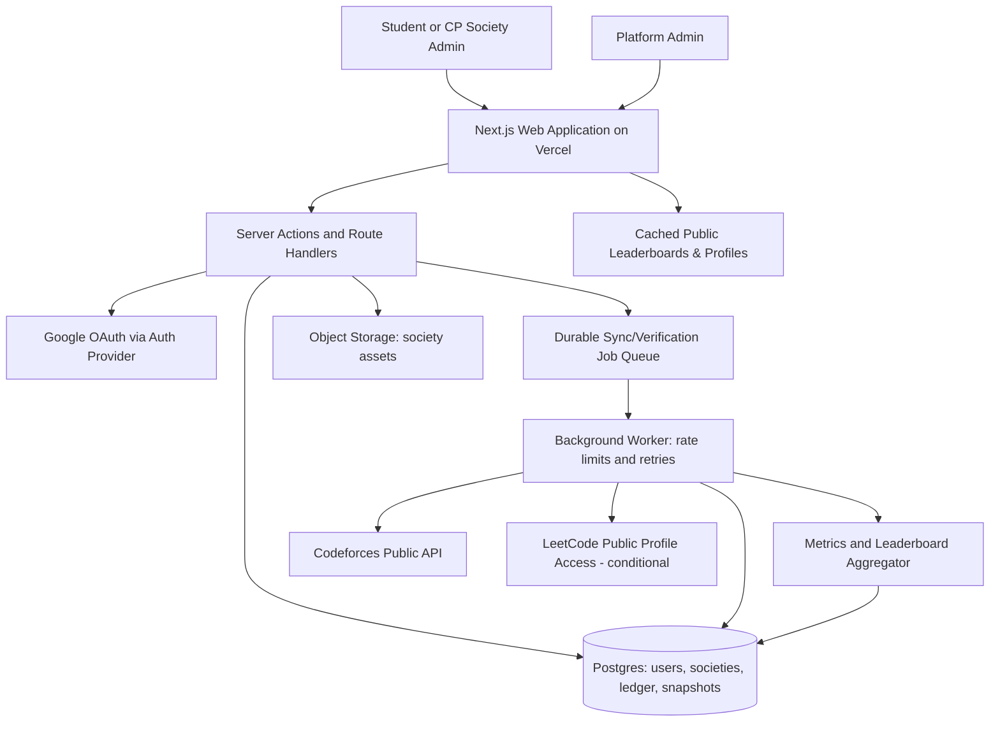
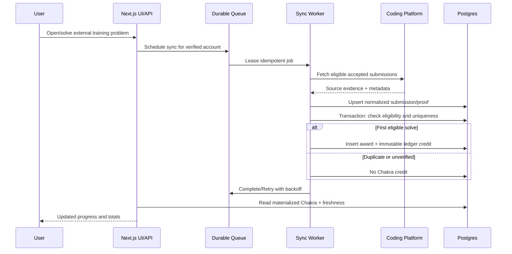

# AlgoGym 2.0 — System Architecture

**Version:** 1.0  
**Date:** 17 October 2026  
**Status:** Proposed technical architecture; validate against repository and production data before implementation  
**Aligned with:** `prd.md` — AlgoGym 2.0 Product Requirements Document  
**Repository:** https://github.com/Symmetry7/AlgoGym  
**Live application:** https://algogym.vercel.app

## 1. Executive architecture decision

**Target: Next.js App Router + TypeScript, Supabase Postgres/Auth, Tailwind CSS, and server-side integration workers.** Migrate the existing React + Vite application **incrementally** into Next.js, preserving working training behavior, history, accounts and components where compatible. The current repository was previously assessed as React/TypeScript/Vite with Tailwind, Radix UI, TanStack Query, charting libraries, and a Supabase client dependency; verify all actual production services, schemas, and auth before modifying them. An SDK dependency is not proof that Supabase already hosts production data.

**Why this architecture:** one TypeScript web app with server-rendered public pages, authenticated dashboards, protected route handlers and server actions for simple mutations, relational integrity for societies/awards, and separate durable workers for rate-limited external coding-platform syncs. Do **not** create microservices or Kafka for V1.

### Explicit out of scope (V1)

AlgoGym-hosted online judge, AI coaching, social messaging, payment system, cash-equivalent currency, native mobile applications, a combined Codeforces/LeetCode contest rating, and speculative gamification unrelated to progress.

## 2. Non-negotiable invariants

1. A user owns exactly one AlgoGym identity; Google OAuth provides sign-in, but **does not prove** Codeforces/LeetCode account ownership.
2. A verified external coding account is linked to no more than one active AlgoGym user.
3. A person can have at most one active **competitive** society membership at a time in V1; many societies may exist under a college.
4. A user earns **one Chakra award per provider + canonical problem** for the first eligible independently verified accepted solve, not on every resubmission or training-list appearance.
5. Codeforces rewards follow PRD ranges through **3500**, LeetCode Easy/Medium/Hard are **15/45/110**. LeetCode awards remain **disabled** until individual qualifying accepted submissions can actually be verified by a compliant, dependable integration.
6. Chakra is an auditable ledger, never a frontend counter. Reversals are append-only; policy version and difficulty at award time are stored.
7. Ratings from incompatible providers are **never blended** into one universal rating. Ranking metric, platform, period, population and last-refresh time must be explicit.
8. Inter-society ranking must be normalized rather than using raw member-count-driven Chakra totals. Historical society membership is time-bounded.
9. Existing user data and production functionality must survive migration, with rollback and a parity checklist before cutover.

## 3. Target technology stack

| Layer | Decision | Notes |
|---|---|---|
| Web framework | **Next.js App Router** with React and TypeScript (supported stable release at implementation time) | Route groups, server components, layouts, metadata, route handlers, selective server actions |
| UI | Tailwind CSS + shadcn/ui-style components based on Radix UI primitives | Reuse compatible existing components, tokenized design system |
| Client data | TanStack Query where client-side polling/interaction benefits | Avoid duplicating all server data in client state |
| Forms and validation | React Hook Form + Zod | Validate again at server boundary |
| Visualization | Recharts, retaining existing chart library only where beneficial | Server-aggregate chart series rather than fetching entire raw submission history |
| Authentication | Supabase Auth Google OAuth + `@supabase/ssr` **if production migration audit supports Supabase** | Secure cookie-backed SSR sessions, provider configuration; do not run a competing auth system |
| Database | Postgres, preferably Supabase managed Postgres | Foreign keys, uniqueness, constraints, RLS, transactional ledger |
| File storage | Supabase Storage or existing compatible object storage | Limited society logos/covers; size/type policy |
| Durable tasks | Postgres-backed jobs via existing service/provider if available; otherwise managed queue + dedicated worker | Retries, leasing, idempotency and rate-limit controls; **not** in-memory cron state |
| API layer | Next.js route handlers for external integrations/webhooks and API consumers; server actions for tightly scoped UI mutations | Separate application services from route/controller code |
| Hosting | Vercel for Next.js; managed worker runtime for background ingestion | Deployment secrets and per-environment configuration |
| Testing | Vitest/unit, Playwright/e2e, database migration/integration tests | Permission, award, replay, leaderboard tests are release gates |
| Observability | Structured logs, error reporting, job metrics and web vitals | No OAuth tokens or ownership challenges in logs |

**Fallback decision:** If the existing production identity/database layer is not Supabase, retain it during the UI migration and write an explicit identity/data migration plan; do not silently replace running data.

## 4. Context and container diagram



**Trust boundaries:** Browser is untrusted. Authenticated server routes enforce authorization. Worker credentials and privileged database keys remain server-only. Third-party source data is evidence to validate, not an authority to write user balances directly.

## 5. Next.js application structure

```text
src/
  app/
    (public)/
      page.tsx                          # marketing/home
      leaderboard/page.tsx              # member/society/college ranks
      societies/page.tsx
      societies/[slug]/page.tsx
      profile/[handle]/page.tsx
    (auth)/
      sign-in/page.tsx                   # accessible OAuth fallback
      auth/callback/route.ts
    (app)/
      layout.tsx                         # authenticated shell
      dashboard/page.tsx
      onboarding/page.tsx
      training/page.tsx
      training/[problemId]/page.tsx
      statistics/page.tsx
      settings/accounts/page.tsx
      society/page.tsx                  # own society overview
      society/members/page.tsx
      society/requests/page.tsx
    (admin)/admin/
      societies/page.tsx
      disputes/page.tsx
      integrity/page.tsx
    api/
      integrations/codeforces/verify/route.ts
      integrations/leetcode/verify/route.ts
      integrations/sync/route.ts       # internal, signed, if needed
  components/
    auth/ training/ societies/ leaderboards/ analytics/ ui/
  features/
    auth/ profiles/ societies/ training/ chakra/ leaderboard/ statistics/
  lib/
    auth/ db/ validation/ permissions/ providers/ observability/
  server/
    services/ repositories/ jobs/ policies/
  styles/
workers/
  sync-codeforces.ts
  sync-leetcode.ts                       # conditional/fails closed
  compute-leaderboards.ts
  refresh-analytics.ts
supabase/
  migrations/
tests/
  unit/ integration/ e2e/
```

Route names are proposed, not a demand to break existing SEO paths. Maintain redirects/aliases when migrating established URLs.

### Rendering split

- **Server components / cached reads:** public societies, public leaderboards, public profiles, pre-aggregated statistics.
- **Client components:** filters, member management tables, training interactions, charts, copy-challenge interaction, accessible modal.
- **Server actions / route handlers:** membership actions, profile linking, training selection, moderation and verification; all input validated and authorized server-side.
- **Background workers:** external submission ingestion, scoring, statistics materialization, leaderboard recomputation. Never perform long provider crawls in request handlers.

## 6. Identity, authentication and account verification

### Google sign-in

1. A public route is readable without sign-in. A protected interaction opens a compact Google OAuth modal with accessible redirect fallback.
2. Auth provider completes Google OAuth using protected state/PKCE and allowed callback URLs.
3. Next.js server validates a session and resolves/creates the `users` row by stable provider identity, **not** email alone.
4. First-time users enter onboarding; existing verified accounts resume dashboard without repeated prompts.
5. Middleware may optimize redirects, **but** server actions and database policies must still enforce authorization.

### Linked platform ownership proof

1. User enters normalized Codeforces or LeetCode handle.
2. Backend confirms handle existence where the provider supports it, creates 10-minute challenge (`challenge_hash`, expiry, attempts, provider, user, handle) and returns the one-time plaintext challenge to the requester.
3. UI instructs user to place challenge in a **public editable field**. Codeforces candidate is the First Name (English) visible in `user.info`; **confirm field behavior in the live provider**. LeetCode Summary is a **candidate only**; verify public retrieval reliability and terms before enabling.
4. Verification endpoint fetches a fresh uncached profile on the **server**, compares exact token, checks expiry, owner, platform, handle and rate limits, then commits a verified link transactionally.
5. Claim collision invokes dispute/recovery process. Do not silently move a handle between users.
6. After success, invite user to restore the field. Keep audit timestamp and proof metadata, never passwords/cookies.

**Critical LeetCode gate:** A publicly readable profile field may support ownership proof but not necessarily per-problem accepted-submission verification. These are independent gates. If the latter is unavailable or unreliable, expose LeetCode stats where allowed but do **not** award LeetCode Chakra or claim fully verified solves.

## 7. College and CP society tenancy / access model

- `college` is an institution, `society` is a community attached to one college, and `membership` links one user to one society with status and effective dates.
- Society creation starts as `pending`, platform admin verifies identity/authorization before `approved` publication.
- Membership workflow: `requested → active/rejected`, optionally `invited → active`, and `active → left/removed` with immutable effective timestamps.
- One active **competitive** membership per user is enforced in DB (partial unique index) and checked in domain logic.
- Society admins manage only their own society; platform admins handle verification, cross-society conflicts, fraud and appeals.
- College league aggregate uses each eligible verified member once, regardless of number of societies under the college, preventing cross-society duplicate contribution.
- Transfers preserve personal Chakra and historical affiliation; period society rankings count only solves awarded in eligible membership windows. Transfer cooldown proposed 30 days (admin-configurable).

### Authorization matrix

| Action | Student | Society moderator | Society admin | Platform admin |
|---|---|---|---|---|
| View approved public society | Yes | Yes | Yes | Yes |
| Submit own membership request | Yes | Yes | Yes | Yes |
| Review join requests | No | Assigned society | Own society | Any society |
| Edit society presentation | No | Delegated | Own society | Any society |
| Verify/suspend society | No | No | No | Yes |
| Adjust Chakra ledger | No | No | No | Controlled reversal + audit |
| View another society's private roster data | No | No | No | Limited, authorized audit only |

Use RLS for row boundaries **and** application-level capability checks. Service-role credentials must never reach the browser.

## 8. Relational data model

All tables should use stable UUID primary keys (unless importing a known stable ID), UTC timestamps and explicit foreign keys. Suggested core entities:

| Table | Important fields / constraints |
|---|---|
| `users` | `id`, `auth_identity_id` unique, display_name, avatar_url, created_at |
| `linked_accounts` | `user_id`, `platform`, `canonical_handle`, verified_at, status; unique `(platform, canonical_handle)` among active claims |
| `ownership_challenges` | `user_id`, `platform`, `canonical_handle`, token_hash, expires_at, attempts, used_at, created_at; only one live challenge per tuple |
| `colleges` | `id`, normalized_name, slug unique, location metadata, verification status |
| `societies` | `id`, college_id FK, unique college-scoped slug, created_by, status, title, description, logo_path |
| `society_applications` | requested admin, evidence reference, decision actor/time/reason |
| `memberships` | user_id, society_id, role, status, effective_from, effective_to; unique active competitive user |
| `problems` | platform, canonical_problem_id, slug/url, Codeforces rating or LeetCode difficulty, tags; unique `(platform, canonical_problem_id)` |
| `training_catalog_items` | problem_id, track, visibility, ordering, curator; no duplicate reward identity |
| `external_submissions` | provider submission ID if available, user_id, linked_account_id, problem_id, verdict, submitted_at, ingested_at, source/proof; unique provider event identity |
| `chakra_policies` | version, effective_at, rating brackets, LeetCode mapping, approved_by; immutable after activation |
| `chakra_awards` | user_id, problem_id, platform, accepted submission/proof ref, rating/difficulty snapshot, policy_version, points, earned_at, created_at; unique `(user_id, platform, problem_id)` for award grant |
| `chakra_ledger` | award_id, user_id, delta, kind=grant/reversal, reason, reference, created_at; immutable event record |
| `provider_sync_state` | account_id, cursor/watermark, last_success_at, status, error_count, next_retry_at |
| `analytics_daily` | user_id, date, platform, topic and difficulty slices, solves, Chakra; derived materialized facts |
| `leaderboard_snapshots` | scope, metric, window_start/end, eligibility_policy, subject_id, rank, score, computed_at, data_version |
| `admin_audit_events` | actor_id, action, subject_type/id, reason, timestamp, metadata (nonsecret) |
| `job_runs` | kind, idempotency_key, state, attempts, leasing and last_error metadata |

### Important database constraints

- A filtered unique index for active verified platform handles (normalization and provider case rules handled centrally).
- A filtered unique index for one active competitive membership per user; guard against race conditions with transaction locking.
- `chakra_awards` unique `(user_id, platform, problem_id)` and transactional creation of ledger credit.
- Verified accepted events are deduplicated by provider submission key (where supported); ensure canonical problem identifiers do not depend on URL formatting.
- Foreign keys, checks on legal status transitions, limited PII retention, encrypted secrets as required.
- Migration files are version-controlled, reviewed and reversible where feasible; production backfills are restartable.

## 9. Training and Chakra computation

Training catalogs link to **external** platform problems; AlgoGym does not host its own judge in V1. The only reliable trigger for an award is an independently confirmed eligible accepted solution from a verified linked account.

### Codeforces award schedule (from PRD)

| Problem rating | Chakra |
|---|---:|
| 800–999 | 10 |
| 1000–1199 | 15 |
| 1200–1399 | 25 |
| 1400–1599 | 40 |
| 1600–1799 | 60 |
| 1800–1999 | 85 |
| 2000–2199 | 115 |
| 2200–2399 | 150 |
| 2400–2599 | 190 |
| 2600–2799 | 240 |
| 2800–2999 | 300 |
| 3000–3199 | 375 |
| 3200–3399 | 475 |
| 3400–3500 | **600** |
| Above 3500 | **600 provisional cap**; policy review before changing |

Missing/unrated Codeforces problem ratings must **not** be guessed; show unavailable/ineligible until an explicit admin-defined policy exists. For 3500+ cap use the PRD policy; this is not a Codeforces rating conversion.

### LeetCode schedule (from PRD)

| Difficulty | Chakra |
|---|---:|
| Easy | **15** |
| Medium | **45** |
| Hard | **110** |

**Feature flag:** `ENABLE_LEETCODE_CHAKRA=false` until submission-level proof works reliably under the provider's supported access rules; connected accounts/aggregate solve counters alone do not meet the requirement.

### Award processing sequence



### Eligibility and historical rules

- The event's accepted-submission timestamp must be after the user's Chakra activation time, subject to the explicit PRD policy for imported history.
- Canonical platform and problem identity are used for uniqueness; solving the same problem in multiple courses grants only one award.
- Store rating/difficulty and policy version **at award time**. A later Codeforces re-rating or LeetCode difficulty change does not retroactively rewrite existing awards.
- Never award on arbitrary user clicks, frontend marks, username existence, or changes in total solved count.
- Use Postgres transaction + unique index rather than a check-then-insert race. On conflict, return already-credited result.
- Reversal credits are separate immutable ledger rows linked to an original award with actor and reason; materialized balances are derived from ledger deltas.
- Chakra has no redemption value, transfer or paid market; no streak multipliers in V1.
- Ingestion failure means **pending/stale**, never fake success.

### Simple pseudocode

```ts
async function awardVerifiedSolve(event: VerifiedAcceptedSolve) {
  assertAccountVerifiedForUser(event.userId, event.platform, event.handle);
  assertEventAfterActivation(event);
  assertProblemEligible(event.problemId, event.platform);
  const points = activePolicy(event.acceptedAt).pointsFor(event.ratingOrDifficulty);
  if (points == null) return { status: 'ineligible' };
  return database.transaction(async (tx) => {
    const award = await tx.insertAwardOnConflictDoNothing({
      userId: event.userId,
      platform: event.platform,
      problemId: event.problemId,
      proofId: event.proofId,
      ratingSnapshot: event.ratingOrDifficulty,
      policyVersion: activePolicy(event.acceptedAt).version,
      points,
      earnedAt: event.acceptedAt,
    });
    if (!award) return { status: 'already-awarded' };
    await tx.insertLedgerEntry({ awardId: award.id, userId: event.userId, delta: points, kind: 'grant' });
    await tx.enqueueAggregationInvalidation(event.userId);
    return { status: 'awarded', points };
  });
}
```

The pseudocode expresses domain invariants, not a framework-specific DB API. Make the active policy selection deterministic and evaluate it once per transaction in implementation.

## 10. Ranking and fairness architecture

### Separate metric families

| Scope | Ranking choices | Rules |
|---|---|---|
| Individual | Chakra; Codeforces current/max rating; verified Codeforces unique solves; LeetCode verified unique solves; LeetCode contest rating where dependable | Each metric has provider + measurement window; no blended rating |
| Society | Normalized Chakra; period member participation; median Codeforces rating; verified unique solves per active eligible member | Show sample size, policy and freshness |
| College | Same normalized metrics but **deduplicate members across affiliated societies** | Each eligible member contributes once |

**Default society Chakra methodology:** average Chakra earned in the selected period by the top **N=10** eligible active members, with minimum **5** qualifying members; use `min(10, eligible_count)` as actual denominator for qualifying societies. Societies below minimum are marked *provisional / not ranked*. Always show member count, N used, period, tie-breaks and unnormalized Chakra separately. This preserves the PRD's fairness rule and limits dominance by large societies.

**Period attribution:** A user's personal lifetime Chakra persists across transfers; society **period** Chakra includes only qualifying awards earned while the user's effective membership in that society was active. For a college period score, count each user at most once and respect its eligible membership timestamp. Avoid using a user's full prior lifetime points as a new society's period score.

**Tie breaks:** normalized Chakra -> more distinct qualifying members -> more qualifying unique problems -> stable canonical ID. The exact tie-break may be made metric-specific in `leaderboard_policies`, but must be public and versioned.

**Read model:** workers compute immutable, versioned snapshots (`metric`, `scope`, `window`, `policy`, `computed_at`), with incremental invalidations on new awards, rating refresh and membership changes. Public pages read snapshots rather than scanning raw submissions. Cache server reads with explicit invalidation and user-visible freshness labels.

## 11. Statistics and analytics

### Individual

- KPI cards: total unique verified solves by platform, current and max Codeforces rating, lifetime Chakra, last-30-day Chakra, active days.
- Rating progression, daily/weekly solve heatmap, difficulty histogram, topic/tag coverage, solved-problem timeline, Chakra earned over time, recent verified activity.
- Link chart points to verifiable source problems where possible; make missing/unsynced data visually explicit.

### Society admin

- Active/total members, verified rate, join queue, per-member activity, participation rate, society Chakra trend, member difficulty and rating distribution, topic strengths.
- Never show a guessed unified rating or use raw aggregate solves as proof of exact individual activity without source evidence.

### Pipeline

`Provider submission proof -> normalized event -> award ledger -> daily materialized metrics -> leaderboard snapshot -> chart-friendly read API`.

- Invalidate impacted daily bucket and affected leaderboards on new evidence/reversal/membership transfer.
- Materialize costly aggregations; precompute multiple time windows (30-day, semester, lifetime) where applicable.
- UI must handle zero history, unknown ratings, empty leaderboards, partial provider outages, and timezones.
- Ensure queries use indexes on `user_id/date`, `society_id/effective periods`, `provider/problem_id`, and snapshot selectors. Use pagination for member-level tables.

## 12. External integration and synchronization

### Codeforces

Use official available endpoints where supported, such as `user.info` for rating/profile and `user.status` for submissions. Apply provider limits, pagination/cursors where applicable, backoff on rate limits, and cache metadata responsibly. Handle renamed handles, non-rated problems, duplicated contest/gym identifiers, old submissions and unavailable provider responses.

### LeetCode

Treat API/profile availability and terms as a feasibility gate. Investigate a legitimate way to retrieve (a) editable public ownership challenge and (b) **individual accepted solve events with reliable timestamps and identity**. These are separate capabilities. Do not require a user's session cookie or password, scrape protected endpoints, or silently trust unverified aggregate counters. Disable ranked LeetCode awards while proof is unavailable; the architecture supports later activation without rewriting the Chakra engine.

### Durable sync mechanics

- Per-provider concurrency/rate-limit buckets and per-account sync state.
- Incremental job after relevant user actions, scheduled catch-up, bounded history backfills and admin-triggered troubleshooting.
- Durable enqueue and retry with exponential backoff/jitter; dead-letter/failed-job review.
- Unique `(provider, provider_event_id)` or equivalent stable evidence key; idempotent job key, reprocessing-safe award logic.
- Record last success, next scheduled sync, retry count and data freshness; prefer last known verified data during outages.
- Provider status changes should not create phantom new Chakra awards.

## 13. Security, privacy and abuse controls

1. HTTP-only secure session cookies, strict callback allowlists, CSRF protection on state-changing requests, OAuth PKCE as supported, security headers and no auth tokens in logs.
2. Validate all external input with Zod/service validation; encode/sanitize profile-generated content and asset uploads.
3. Enforce tenant ownership with Postgres RLS and protected server permissions; test privilege escalation across societies.
4. Ownership tokens hashed at rest, expire in 10 minutes, per-IP/per-user/provider rate limits, single-use challenges and audit records.
5. Safe handle unlink/relink and contested-account process requiring renewed proof and human review as appropriate.
6. Prevent society impersonation, invite farming, membership hopping and sockpuppet/multi-account exploitation; flag anomalous award velocity without automatically making punitive decisions.
7. Platform admins can request reversible score corrections with a recorded reason; no unlogged mutation of award amounts.
8. Store the minimum personal data needed, define retention/deletion policies, support export/deletion requests where required, and respect provider terms.
9. Store privileged DB/service keys and provider secrets solely in protected environment variables; rotate secrets and keep development/staging isolated.
10. Instrument audit trails and integrity checks for award count versus ledger balance, duplicate external handles, inconsistent membership windows, and snapshots past freshness targets.

## 14. API / service contract sketch

Endpoint paths are examples, not a second unrestricted public API. Prefer server actions for authenticated UI mutations while retaining explicit service methods.

| Operation | Method/route example | Authorization | Side effect |
|---|---|---|---|
| Current user profile | `GET /api/me` | Signed-in | Read only |
| Start challenge | `POST /api/accounts/challenges` | Signed-in + rate limit | Create expiring challenge |
| Verify external handle | `POST /api/accounts/verify` | Challenge owner | Mark linked account verified |
| Society application | `POST /api/societies` | Signed-in | Pending review |
| Join society | `POST /api/societies/:id/requests` | Signed-in | Membership request |
| Decide membership | `POST /api/societies/:id/requests/:id/decision` | Admin/moderator of society | Approve/reject |
| Personal stats | `GET /api/statistics/me?window=30d` | Signed-in | Derived read |
| Leaderboard | `GET /api/leaderboards?scope=society&metric=chakra&window=30d` | Public for approved entities | Snapshot read |
| Internal provider sync | Worker job or signed internal trigger | Worker identity only | Import proof/award |
| Review society | Admin-only action | Platform admin | Approve/reject/suspend + audit |

Apply validated paging, bounded date ranges, caching, request shaping and stable error codes. UI must never directly submit its own Chakra amount or leaderboard score.

## 15. UI/UX architecture and page map

Design direction: modern, dark-friendly developer SaaS; distinctive but restrained Chakra visual language, no copyrighted Naruto artwork. Prefer clear information hierarchy over gamified visual noise.

- **Public:** Home, Society directory/details, Individual profile, Leaderboard tabs (individual / society / college) and transparent metric selectors.
- **Onboarding:** Google sign-in -> verified Codeforces link -> optional LeetCode link -> college/society membership.
- **Authenticated:** Dashboard, Training with difficulty/topic filters and verified reward status, Statistics, Accounts/Privacy settings.
- **Society:** Society overview, member roster, join queue, activity dashboard, settings (permission-gated).
- **Platform admin:** Pending society verification, disputed handle links, synchronization health, Chakra corrections and audit.

Reusable UI primitives: KPI tile, percentile/difficulty bar, rating line, activity heatmap, member row, leaderboard rank row, Chakra event chip, provider freshness badge, responsive filters and accessible modal. Motion must be reduced under `prefers-reduced-motion`; achieve keyboard and screen-reader usability. Mobile navigation and large society tables need explicit responsive behavior.

## 16. Performance, availability and observability

- Target p75 LCP < 2.5 seconds on representative mobile landing/dashboard conditions (measure); focus interactive performance on navigation and filters.
- Target cached common profile/leaderboard read server times under 500 ms in staging; monitor tail latency and database execution plans.
- Public pages can be cached and revalidated; authenticated or privacy-sensitive responses must never share caches across users.
- During Codeforces/LeetCode downtime, serve previously verified snapshots with explicit `last updated` and `stale` state.
- Observability: error rate, sync lag per provider, failed job count, queue age, rate-limit responses, duplicate-credit conflicts, negative Chakra anomalies, snapshot generation time, page web vitals.
- Disaster recovery: tested Postgres backups/PITR if available, storage backups as applicable, migration rollback plans and disaster drill for ledger reconciliation.

## 17. Migration plan: Vite -> Next.js without losing product data

**Phase 0 — Audit and freeze contracts**

1. Clone current repository and inventory routes, components, training catalog, auth paths, persistence, charts, external calls, environment variables and deployment configuration.
2. Record current production schema and backed-up data, user IDs, linked handles, solved history, stats semantics and SEO URLs.
3. Establish test fixtures and baseline screenshots; identify Vite-only client globals, browser-only dependencies and incompatibilities with RSC/SSR.
4. Confirm Google OAuth callback and whether current Supabase project is actually production-backed.
5. Produce a migration map: old route -> Next.js route, old user ID -> stable new identity, old solved record -> verified proof eligibility.

**Phase 1 — Next.js shell with parity**

1. Initialize Next.js App Router + TypeScript within a migration branch, migrate Tailwind tokens, Radix components and asset pipeline.
2. Port public pages and old training/stats pages behind compatibility adapters; use client boundaries for browser-only chart code.
3. Reproduce working authentication and protect user data; keep URLs or add permanent redirects.
4. Run route parity, visual regression and smoke tests against staging. **No Chakra rewards yet.**

**Phase 2 — Communities and ownership proof**

1. Add college/society/membership schema, admin moderation, role policies and society pages.
2. Implement Google login and Codeforces verification; validate LeetCode fields before enabling.
3. Import existing user data using idempotent backfills with dry runs and reconciliation.

**Phase 3 — Verified training and Chakra**

1. Add normalized provider submissions, durable queue, Codeforces sync and exactly-once logical awarding.
2. Initialize PRD policy version and Chakra ledger; distinguish legacy solves from Chakra-eligible **new** solves.
3. Add individual Chakra totals and audited correction flows; gate LeetCode Chakra until submission proof exists.

**Phase 4 — Leaderboards and analytics**

1. Build individual/society/college snapshots with 5-member minimum and top-10 normalized scoring.
2. Launch society admin insights, topic heatmaps, progression charts, freshness labels.
3. Validate aggregate figures against raw evidence and test transfer edge cases.

**Phase 5 — UI refresh and rollout**

1. Apply final design system across all paths, responsive layouts and accessibility standards.
2. Canary/release feature flags by society or cohort, measure errors and compare rankings.
3. Prepare rollback that turns off new ranking/awards without deleting historical ledger or changing old URLs.

**Rollout philosophy:** No big-bang production cutover. At each stage protect identity, training history and confirmed awards; rely on verifiable parity criteria rather than visual completion alone.

## 18. Acceptance criteria and architecture quality gates

- [ ] Next.js App Router deployment works with all required public and protected routes.
- [ ] Every current critical AlgoGym workflow has a migrated equivalent or documented deliberate removal.
- [ ] Google login persists; server validates session and role on each write.
- [ ] Users prove ownership of provider handles, with expiry, collisions and error cases tested.
- [ ] Society admins cannot access or mutate another society's private data.
- [ ] No user can occupy two competitive societies simultaneously under race conditions.
- [ ] One Codeforces problem yields at most one Chakra award, including replay and concurrent worker tests.
- [ ] 3500-rated Codeforces problem awards 600 Chakra; LeetCode Easy/Medium/Hard mapping is 15/45/110.
- [ ] LeetCode awards stay disabled without individually verified accepted-submission proof.
- [ ] Ledger can be replayed/reconciled to displayed Chakra totals; corrections have audit references.
- [ ] Period society ranks exclude pre-membership earning, display N/minimum membership and stay consistent after transfer.
- [ ] College aggregation deduplicates students across societies.
- [ ] External outages show last valid data with accurate stale indicators, not bogus zero totals.
- [ ] Public and private dashboard caching respects data boundaries; mobile screens and a11y pass checks.
- [ ] Test coverage includes auth, permissions, SQL uniqueness, policies, Chakra boundaries, retries, backfills, schema migration and provider failures.

## 19. Decision log and outstanding validations

| Decision | State |
|---|---|
| Migrate from existing Vite app to **Next.js App Router** | **Approved by product owner** |
| Stay TypeScript, Tailwind/Radix and reuse compatible React components | Proposed |
| Use Supabase Postgres and Google OAuth | Proposed; verify existing production architecture |
| One active competitive society membership per user | PRD baseline |
| Top-10 eligible Chakra average, min-5 society eligibility | PRD baseline; confirm as launch policy |
| Codeforces scoring up to 3500 and provisional cap beyond | PRD baseline |
| LeetCode difficulty rewards 15/45/110 | PRD baseline, **not enabled** until reliable solve proof |
| LeetCode public Summary and per-problem proof availability | **Blocking integration feasibility checks** |
| Provider sync cadence and retention windows | Operational decision pending rate-limit test |
| Imported historical solves and the Chakra activation cutoff | PRD baseline: only new qualifying solves; verify old-data handling |
| Society transfer cooldown | Proposed 30 days; confirm product policy |

## 20. Delivery order / definition of done

Build in this order: **migration + auth → identity verification → society membership → Codeforces ingestion + Chakra ledger → leaderboards → enhanced statistics → cohesive UI refresh**. LeetCode profile statistics may launch independently, but LeetCode Chakra must wait for verifiable accepted-solve evidence.

The architecture is complete only when a verified Codeforces submission travels from provider evidence through an idempotent credit transaction to accurate user/society/college dashboards, all permissions are tested, and the Vite-to-Next.js migration passes a data-parity and rollback rehearsal.
# Recording-driven extension — 17 October 2026

See `VIDEO_FEATURE_MAP.md`, `PRD.md`, `DESIGN.md`, and `IMPLEMENTATION_PLAN.md` for the latest recording inventory. Preserve the existing Next.js/Supabase modular monolith and account records. Extend existing `training_lists`/`training_items` for study sheets instead of creating a competing catalog; private workspace state and notes use ownership-aware RLS. Personal study completion never authorizes Chakra. Contest adapters run on the server, subscriptions persist per user, and reminder delivery is separate from saved interest/calendar export. Public portfolio and leaderboard projections must enforce opted-in visibility in the database/server. GitHub ownership, company content, payments and notification delivery have explicit provider/configuration gates; a marketing preview cannot establish integration support.

## Society invitations and extended ownership (October 18)
`POST /api/societies/register` validates name, optional college ID and description, generates a unique slug, and calls the authenticated `register_society` RPC. The transaction creates the visible society, active creator/admin membership and private invite record. The internal approved visibility enum is retained for compatibility without assigning institutional approval metadata.
`/api/societies/invite` previews token-linked identity on GET; authenticated POST retrieves the persistent link/locally encoded QR for active members or joins via token. Private tokens have no direct anon/authenticated table grants; security-definer RPCs validate membership/authentication. Joining locks per user and is idempotent, preserving the one-competitive-membership index and suspension restrictions. Email/Google sign-in preserve a validated society invitation return path.
The verification Edge Function uses dedicated server-only adapters for AtCoder affiliation, CodeChef public name, GitHub official REST bio, and GFG public profile bio. Requested identities and expected fields are checked before exact challenge comparison. Existing token hashes, rate limits, expiry and atomic ownership claims are reused. Sync queue selection explicitly includes only the two implemented analytics providers, CF and LC.
