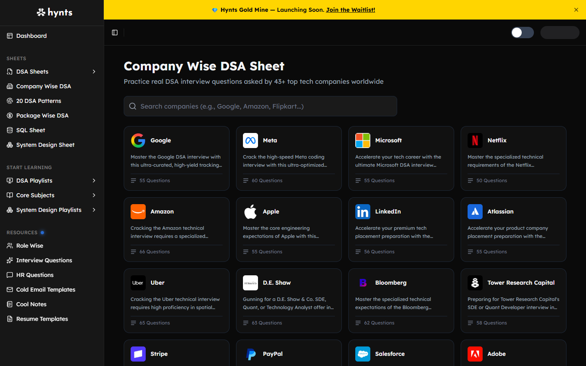

# Hynts preparation interface: design extraction

Source: [company directory](https://hynts.in/preparation/company-wise-dsa-sheet/) and [Google sheet](https://hynts.in/preparation/company-wise-dsa-sheet/google-dsa-interview-questions/), inspected 2026-10-23. Evidence combines live browser screenshots in `artifacts/interview-qa/reference-*.png`, DOM interaction inspection, and a Firecrawl branding/images/full-page screenshot extraction. The named Design Extractor MCP was not exposed in this session. Firecrawl's automatic branding parser reported a _light_ scheme, while the inspected browser screenshot was dark; the screenshots and computed styles take precedence for this workspace.

## Reference image

## Layout

| Element           | Observed desktop geometry                                    | Implementation target                                       |
| ----------------- | ------------------------------------------------------------ | ----------------------------------------------------------- |
| Left navigation   | 255px fixed rail, grouped labels and 35px links              | 252px sticky rail, 35px links, mobile drawer                |
| Top area          | 48px promotional strip plus 63px utility row                 | One functional 64px AlgoGym header; avoid copying promotion |
| Content inset     | ~49px from rail at 1440px                                    | 48–64px, narrowing on tablet/mobile                         |
| Directory heading | 30px, ~36px line                                             | 30–31px, medium-bold                                        |
| Search            | ~672 × 50px, 10px radius                                     | max 680 × 48px                                              |
| Company grid      | Four columns at 1440px, 16px gutters                         | Four/three/two/one responsive columns                       |
| Company card      | ~260 × 159px, thin border, 12px radius                       | 157–160px, dense copy and exact stored count                |
| Company sheet     | Heading/description, progress, inline filters, compact table | Same reading order and density                              |
| Question row      | ~67–70px height, seven aligned columns                       | 67px desktop; horizontal scroll where needed                |

## Tokens

The reference's rendered dark palette is approximately page `#09090a`, rail `#151515`, raised surface `#111113`, divider `#29292d`, primary text `#f3f3f4`, secondary text `#a4a4ad`. Firecrawl identified **Lexend** for headings and body, with 30px major headings and 14px body. The reference uses compact spacing in 8px increments, 10–12px radii on input/cards, and minimal shadows. Extracted asset links include Hynts and company logos; AlgoGym uses its own mark and text-based company identities, not source artwork.

The AlgoGym adaptation keeps the brand lilac for focus and active states, while preserving the source's low-chroma content surfaces. Interactive states use 140–220ms transitions on background, border, and small transform only. Reduced motion removes transitions. Tables, filters, completion, and bookmarks are dense and keyboard reachable.

## Component and behavior map

| Component      | Reference behavior                                            | AlgoGym behavior                                              |
| -------------- | ------------------------------------------------------------- | ------------------------------------------------------------- |
| Grouped rail   | Sheets / Start Learning / Resources; active destination       | Same grouping plus user progress and admin entry              |
| Company search | Filters as typed, no separate submit                          | Case-insensitive live filter, explicit empty state            |
| Company card   | Opens named sheet                                             | Opens routed sheet; count comes from placements               |
| Sheet heading  | Logo, title, summary, Read More/Less                          | Text mark, original description, same disclosure              |
| Progress       | Completion count and circular indicator                       | Canonical user state in Supabase; updates optimistically      |
| Filters        | All, Difficulty, Popularity, Bookmarked                       | Composable filters; absent popularity remains unassigned      |
| Question row   | Completion, title, tags, source, difficulty, popularity, save | Accessible buttons, safe source link, persistent shared state |
| Patterns       | Collapsible pattern groups                                    | Accordions with canonical completion                          |
| Other sheets   | Dense question lists or resource collections                  | Original licensed/public links with distinct category pages   |

## Content boundary

The reference's company-specific problem selection, popularity editorial ratings, long descriptions, and logos are not copied. AlgoGym's company pages are labeled editorial practice tracks; they must not claim that a company asked a problem without independent evidence. Counts and progress derive from actual stored assignments. The source's layout and interaction language guide the frontend, while AlgoGym retains its own brand, account system, and content.
