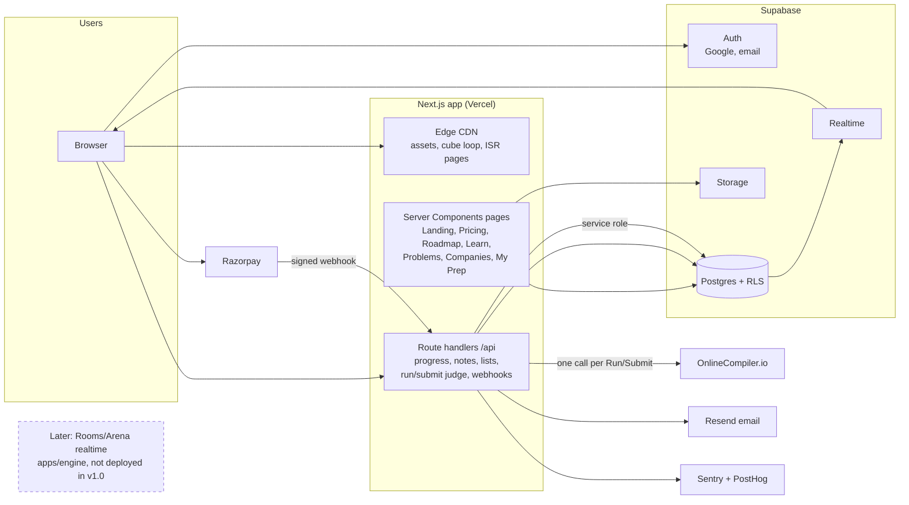
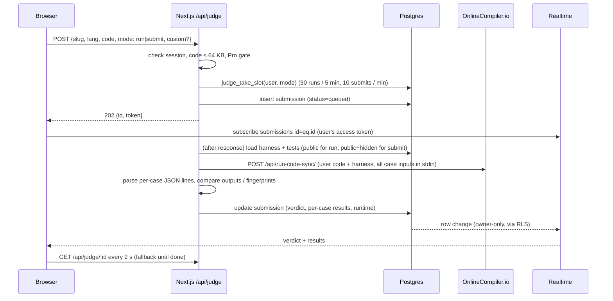
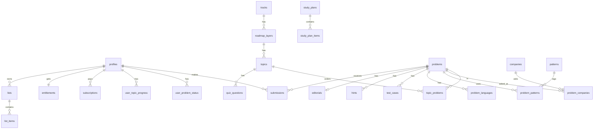

# Algogym — System Architecture

**Version:** 1.0 · **Date:** 24 Nov 2026 · **Status:** Draft for review

Related docs: [PRD.md](./PRD.md) · [DESIGN.md](./DESIGN.md)
Diagram (Eraser): https://app.eraser.io/workspace/egpUpJy9fAPA3ACbDQGI

---

## 1. Summary

Algogym runs as **one Next.js app on Vercel** and **Supabase** for Postgres/Auth/Realtime/Storage. Code runs on **OnlineCompiler.io**, called directly from the Next.js `/api/judge` route handler: one call per Run or Submit (DECISIONS.md 2026-11-27). There is no separate engine service for v1.0; `apps/engine` stays in the repo, unused, for Rooms and Arena later.

- Everything (pages, lessons, problems, progress, billing, judging) lives in Next.js.
- The browser never talks to the code runner, never sees hidden tests or expected outputs, and never decides what it is allowed to see.

### Principles
1. **One deployable.** The Next.js app. No more services until a real bottleneck appears (Rooms realtime in v1.1 is the first candidate).
2. **Server decides access.** Pro and Rooms entitlements are checked on the server; RLS backs it up.
3. **Content is fast and indexable.** Landing, Learn and problem statements are server-rendered and cached.
4. **Additive data changes.** Production has real users and, until launch, the legacy app shares the database: new tables and columns only. Old tables move to a `legacy` schema at the launch cutover (BUILD_GUIDE M20), never before.
5. **Swappable judge.** The code runner sits behind one adapter interface (`packages/judge`: `run({ language, source, stdin, timeoutMs, memoryMb })`), so OnlineCompiler.io can be replaced by self-hosted Judge0 or another runner without touching the harnesses or the judge.

## 2. Architecture diagram



## 3. Components

| Component | Tech | Hosting | Responsibility |
| --- | --- | --- | --- |
| Web app | Next.js (App Router, React Server Components), TypeScript, Tailwind | Vercel | All pages, SSR/ISR, route handlers, auth session, entitlement checks, Razorpay webhook |
| Lessons | MDX files in the repo (`content/learn/<track>/<topic>.mdx`) | Built by Vercel | Free Learn pages; versioned in Git, reviewed by PR, statically generated |
| Database | Supabase Postgres | Supabase (Mumbai region) | Content metadata, problems, tests, users, progress, submissions, billing, Rooms |
| Auth | Supabase Auth | Supabase | Google + email; existing accounts kept |
| Realtime | Supabase Realtime | Supabase | Pushes submission status changes to the browser (no WebSocket server needed on Vercel) |
| File storage | Supabase Storage | Supabase | Lesson images, company logos, topic icons |
| Judge | `/api/judge` route handler + `packages/judge` | Vercel (Node runtime, 60 s limit) | Checks the session and rate limit (Postgres `judge_take_slot`), records the submission, then (after responding) builds one runner call (user code + harness, all cases), compares outputs, maps verdicts, writes results |
| Code execution | OnlineCompiler.io (`/api/run-code-sync/`) | SaaS | Runs untrusted code in sandboxes with time/memory limits |
| Engine (unused in v1.0) | Node.js + Express, BullMQ | not deployed | Kept for Rooms/Arena realtime in v1.1+ (`docs/ENGINE.md`) |
| Payments | Razorpay Subscriptions | Razorpay | Pro and Rooms plans, UPI and cards |
| Email | Resend | Resend | Receipts, magic links (if not using Supabase's), Rooms invites |
| Monitoring | Sentry, PostHog | SaaS | Errors in both services, product analytics and funnels |

### Repository layout (monorepo, npm workspaces)
```
algogym/
├─ apps/
│  ├─ web/            # Next.js app (existing repo becomes this)
│  └─ engine/         # Express API + BullMQ worker
├─ packages/
│  ├─ db/             # Generated Supabase types, query helpers (no migrations)
│  ├─ judge/          # Judge interface + local + OnlineCompiler.io adapters + harnesses + verdict mapping
│  └─ shared/         # zod schemas, constants (languages, limits, plans)
├─ supabase/          # Stays at the repo root: migrations/ (source of truth), functions/
├─ content/learn/     # MDX lessons
└─ scripts/           # data/import-companies.mjs (CSV import), seeders, content validators,
                      # build-icons.ts (copies used Devicon/Simple Icons SVGs → public/icons, writes iconMap.ts)
```
`supabase/migrations/` stays where the Supabase CLI and the production migration ledger expect it; moving it would break `supabase db push` against 50 already-applied migrations. npm workspaces (not pnpm) keep the existing `package-lock.json` and tooling.

## 4. Key flows

### 4.1 Run / Submit

- **One runner call per Run or Submit**, never one per test case. The runner is billed and rate-limited per run.
- **Run** uses public examples + up to 5 custom inputs. **Submit** uses public + hidden tests.
- **Hidden outputs never leave the sandbox.** For cases above the visible ones the harness prints a 64-bit FNV-1a fingerprint of the output's canonical JSON (`"digest"`) instead of the output, and the server compares it with the fingerprint of the expected value (`unordered` sums element fingerprints; `float_tolerance` and `double` returns print full output). This also keeps large outputs under the runner's 64 KB stdout limit. Expected outputs are never sent to the runner.
- For hidden cases the server writes **only case number, verdict and runtime** to `submissions.results` — never the input, expected output or actual output (unit-tested in `judge-results.spec.ts`). Public cases may include all three.
- **Realtime relies on RLS:** `submissions` has an owner-only `SELECT` policy (`user_id = auth.uid()`), so a Realtime subscription can only ever receive the subscriber's own rows. Session cookies are httpOnly, so `/api/judge` returns the caller's own access token for the subscription.
- **Time limits:** the function has 60 s (`maxDuration`); judging runs in `after()`. The runner call times out at 40 s, the harness stops itself at its own budget first (≤ 30 s). The client gives up after 90 s. Every failure (timeout, runner busy `429`, monthly quota, outage) writes `status=error` with a message; the code stays in the editor and in localStorage.

### 4.2 Code harness
Each problem has, per language, `starter_code` (what the user sees) and `harness_code` (hidden driver). `/api/judge` concatenates user code + harness and sends **one** runner call whose stdin holds every case input.

The harness, in one process:
1. Reads all case inputs from stdin: one JSON argument list per line (implementation: `packages/judge`, format in DECISIONS.md 2026-11-26).
2. For each case in order: checks the remaining overall time budget; if it is used up, stops and exits cleanly. Otherwise it calls the user's function, times the call itself, and prints **one JSON line** (`{"case":3,"ms":4,"output":…}` or `{"case":3,"error":"…"}`), flushing stdout immediately.
3. Lines carry a per-job nonce embedded in the harness source, so anything the user's code prints goes to console output instead of being read as a result.

The server parses whatever lines arrived and compares each `output` with the expected output using the problem's comparator (`exact`, `float_tolerance`, `unordered`). **Expected outputs never leave the server** — they are not sent to the runner; hidden cases come back as fingerprints (§4.1).

- **Time limits:** overall limit = per-case limit × case count, capped per problem (`problem_languages.max_total_ms`) and never above the runner's 30 s maximum.
- **Cases not run are reported as `not_run`, not lost.** If the budget runs out, or one case hangs and the runner kills the process, every printed case keeps its result. The case in flight when the process was killed gets `time_limit_exceeded`, and the rest get `not_run`.
- Runtime is measured per case by the harness. Memory is the peak for the whole run, as reported by the runner.

### 4.3 Pro entitlement
- Razorpay → `POST /api/webhooks/razorpay` → verify signature → upsert `subscriptions` → recompute `entitlements` for the user.
- Every gated read (locked problem, solution tab, 30/60/90-day company lists) goes through a server helper `can(user, feature)` that reads `entitlements`.
- RLS on `editorials`, `problem_companies` (timeframe ≠ all) and Pro problems' `harness/test` data denies access without an active entitlement.

### 4.4 Learn and roadmap
- Lesson MDX → statically generated at build; `revalidate` on publish.
- Roadmap structure (`roadmap_layers`, `topics`, `topic_problems`) is in Postgres so ordering and the 70/30 free/Pro split can change without a deploy.
- Quiz answers and "lesson read" events → `user_topic_progress`.

### 4.5 Company data import
`scripts/data/import-companies.mjs` reads the company-wise CSVs → upserts `companies`, `problems` (status `pending`, metadata only) and `problem_companies` (frequency, timeframe). Idempotent; re-runnable when data updates.

### 4.6 Rooms (v1.1)
- `orgs` → `org_members` (owner/interviewer) → `rooms` → `room_problems` (from `problems` where `pool = 'room'`) → `room_candidates` (invite token) → `room_attempts` (code, verdicts, timings).
- Candidate workspace uses the same judge flow with `context = room` (no hints, no solutions, timer enforced server-side by `started_at + time_limit`).
- Plan limits (`candidates_per_month`) enforced when an invite is created.

### 4.7 Arena (later)
Socket.io on the engine, matchmaking queue in Redis, duel state machine `queued → matched → in_progress → finished`, ratings in Postgres. Nothing in v1.0 depends on it.

## 5. Data model (v1.0)

> In the database, the `problems` entity below is the table **`catalog_problems`**: the legacy `problems` table (the LeetCode/Codeforces sync catalog) stays in place until launch (DECISIONS.md 2026-11-26). Migration: `supabase/migrations/20261126000000_v1_content_schema.sql`.



| Table | Key columns | Notes |
| --- | --- | --- |
| profiles | id (= auth.users.id), name, avatar, college, target_role | Existing users kept; optional fields |
| tracks | id, slug, name, status (live/soon) | DSA, Patterns, SQL, HR, … |
| roadmap_layers | id, track_id, position, name | "Layer 1 · Foundations" |
| topics | id, layer_id, position, slug, name, icon_url, lesson_path, free_ratio (default 0.7) | lesson_path points to MDX |
| quiz_questions | id, topic_id, question, options jsonb, answer_index | 3 per topic |
| problems | id, slug, number, title, difficulty, category, statement_md, constraints jsonb, source (algogym/leetcode/gfg), source_ref, source_url, status (original/adapted/pending), pool (public/room), is_pro, comparator | |
| topic_problems | topic_id, problem_id, position | Roadmap order; Pro = position beyond free_ratio |
| companies / problem_companies | company: id, slug, name, logo_url · link: problem_id, company_id, frequency, timeframe (30/60/90/all) | |
| patterns / problem_patterns, tags / problem_tags | | |
| problem_languages | problem_id, lang, starter_code, harness_code, time_limit_ms (per case), max_total_ms, memory_kb | harness_code server-only |
| test_cases | id, problem_id, input, expected_output, is_hidden, position | Hidden rows: service role only |
| hints / editorials | problem_id, position, body_md · problem_id, body_md, solutions jsonb | Editorials gated by entitlement |
| submissions | id, user_id, problem_id, lang, code, mode (run/submit), context (practice/room), status, verdict, results jsonb, runtime_ms, memory_kb, created_at | Owner-only SELECT (RLS); hidden cases store case, verdict, runtime only; runs purged after 24 h |
| user_problem_status | user_id, problem_id, status (attempted/solved), solved_at | Drives ✓ and acceptance % |
| user_topic_progress | user_id, topic_id, lesson_read_at, quiz_passed_at, completed_at | Roadmap node states |
| notes / bookmarks | user_id, problem_id, body / created_at | |
| lists / list_items | id, user_id, name / list_id, problem_id | "My Lists" |
| daily_problems | date, problem_id | Daily calendar |
| study_plans / study_plan_items | id, slug, name, is_pro / plan_id, problem_id, module, position | |
| interview_items | id, kind (hr/sql), question, answer_md, companies[], roles[] | Migrated Interview Prep |
| subscriptions | id, user_id or org_id, plan, razorpay_sub_id, status, current_period_end | |
| entitlements | user_id, pro_until | Single source for gating |
| waitlist | id, email, user_id, feature ('arena') | |
| legacy.* | archived old tables | Read-only, kept for user data |

**v1.1 additions:** orgs, org_members, rooms, room_problems, room_candidates, room_attempts, room_usage (monthly counts).

## 6. API surface

### Next.js route handlers (`apps/web/app/api`)
| Method | Path | Purpose |
| --- | --- | --- |
| POST | /api/judge | Create run/submit (rate-limited), judge it after responding |
| GET | /api/judge/:id | Fallback polling if Realtime unavailable (visitor session, RLS) |
| POST/DELETE | /api/bookmarks, /api/notes, /api/lists, /api/lists/:id/items | User data |
| POST | /api/progress/lesson, /api/progress/quiz | Learn progress |
| POST | /api/waitlist | Arena waitlist |
| POST | /api/billing/checkout | Create Razorpay subscription |
| POST | /api/webhooks/razorpay | Payment events (signature verified) |
| GET | /api/health | Uptime check |

Reads for pages happen directly in Server Components (Supabase server client), not through public APIs.

### Engine (`apps/engine`)
| Method | Path | Auth | Purpose |
| --- | --- | --- | --- |
| POST | /v1/jobs | HMAC (shared secret, timestamp, 60 s window) | Enqueue a judge job for a submission id |
| GET | /v1/health | none | Railway health check |
| GET | /v1/metrics | token | Queue depth, Judge0 latency |

## 7. Security

| Threat | Control |
| --- | --- |
| Running untrusted code | Only inside the runner's sandboxes; our servers never execute user code |
| Leaking hidden tests | `test_cases.is_hidden` rows and `harness_code` readable only by service role; never selected in client queries; hidden cases print fingerprints, not outputs; the server writes only case number + verdict + runtime for hidden cases; expected outputs never sent to the runner |
| Forged results from user prints | Result lines carry a per-run 128-bit nonce; user stdout is redirected inside the harness |
| Reading others' submissions | Owner-only `SELECT` RLS policy on `submissions`; Realtime subscriptions depend on it |
| Bypassing Pro | Server-side `can()` checks + RLS on gated tables; no client flags |
| Forged engine calls | HMAC with timestamp; engine not publicly documented; Railway private networking for Redis |
| Judge abuse / cost | Per-user limits in Postgres (`judge_rate_events` + `judge_take_slot`, service role only: 30 runs / 5 min, 10 submits / min), max code size 64 KB, max custom cases 5 |
| Payment fraud | Razorpay signature verification; idempotent webhook handling by event id |
| Secrets | `CODE_RUNNER_KEY` and the Supabase service key only on the server (Vercel env vars, `.env.staging.local` locally) |
| XSS in lessons/statements | MDX from repo only; statements sanitized Markdown; strict CSP |

## 8. Performance and caching
- Landing, pricing, Learn: static/ISR at the edge; cube loop served as WebM/MP4 from the CDN with a poster image.
- Problems list: server-rendered first page, client pagination; Postgres indexes on (category, difficulty), (company_id, timeframe, frequency), trigram index on title for search.
- Workspace: statement server-rendered; Monaco loaded client-side and lazily.
- Supabase in Mumbai (ap-south-1) and Railway in the closest region to India for low latency.

## 9. Environments and deployment

| Env | Web | Engine | DB |
| --- | --- | --- | --- |
| Local | `next dev` | `node --watch` + local Redis (Docker) | Supabase local (CLI) |
| Preview | Vercel preview per PR | Railway PR environment | Supabase branch |
| Production | Vercel production (`release/legacy` until launch, then `main`) | Railway production | Supabase production |

- CI (GitHub Actions): typecheck, lint, Vitest, migration dry-run, content validator (every problem's tests pass against its reference solution in 4 languages), `npx impeccable detect apps/web/src` (UI anti-pattern check, see DESIGN.md §9).
- Icons: `devicon`, `simple-icons` and `lucide-react` pinned in package.json; no runtime icon CDN.
- Migrations: SQL files in `supabase/migrations` (repo root), additive only; destructive changes need a written plan and a backup.

## 10. Observability
- Sentry in web and engine (errors, slow transactions).
- PostHog events: signup, lesson_read, quiz_passed, run, submit, solved, upgrade_clicked, checkout_success, waitlist_joined.
- Judge logs: `judge.failed` and `judge.create_failed` JSON lines in Vercel logs; alert if runner errors exceed 5% for 5 minutes.

## 11. Migration from the current app
1. Production keeps serving the legacy app from `release/legacy` (Vercel Production Branch). New work merges to `main`, which deploys previews only.
2. Remove old features from `main` (M2); strip the onboarding redirect from `AuthGate`.
3. Create new tables with additive migrations only; the legacy app shares the database (M4).
4. Migrate Interview Prep content into `interview_items`; run the CSV import and seed launch problems.
5. Launch cutover (M20): backfill entitlements from legacy subscriptions, repoint the Razorpay webhook, move legacy-only tables to the `legacy` schema (no drops; keep `profiles` and auth users), then switch the Production Branch to `main`.
6. Monitor; drop nothing until 30 days after launch, and only with sign-off.

## 12. Cost (to confirm)
Vercel, Supabase and Railway have paid plans that fit this scale; OnlineCompiler.io is free up to 100,000 runs a month (Starter $10 for 150k, Pro $49 for 1M). Check current prices for each before launch and set a monthly budget (open question in the PRD).

## 13. Decisions and alternatives

| Decision | Chosen | Alternatives considered | Why |
| --- | --- | --- | --- |
| Backend shape | Next.js + one Express engine | Next.js only; full Express API | Vercel can't run queues/WebSockets; full API adds ~2 weeks with no mobile app planned |
| Judge | OnlineCompiler.io, called from Next.js | Hosted Judge0 (RapidAPI), self-hosted Judge0, Piston, an engine service | Owner choice; free tier covers launch, sandboxing handled, one deployable; swappable adapter |
| Judge calls | One submission per Run/Submit, all cases in one harness process | One submission per test case (batch) | Per-case batches cost 12+ billed calls per Submit; see [DECISIONS.md](./DECISIONS.md) |
| Monorepo tooling | npm workspaces, `supabase/` at root | pnpm, migrations in `packages/db` | Keeps the lockfile and the Supabase CLI's migration ledger working |
| Result delivery | Supabase Realtime | Polling, Socket.io | No extra server for v1.0; polling fallback exists |
| Lessons | MDX in repo | Lessons in DB/CMS | Versioned, reviewable, static and SEO-friendly |
| Engine host | Railway | Render, VPS | Simple GitHub deploys, built-in Redis |
