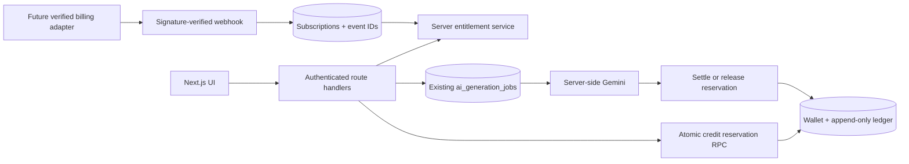

# AlgoGym 3.0 audit and implementation plan

Status: planning baseline, 2026-10-21. This document separates observed behavior from intended work.

## Source audit and feature gaps

| Area | Current code | Required 3.0 gap |
| --- | --- | --- |
| Foundation | Next.js 16 App Router, React 19, TypeScript, Tailwind 3, Supabase Auth/PostgreSQL/RLS, Vercel. | Keep this stack. Avoid a second auth service or speculative Redis. |
| Symm AI | `/training/symm` has Gemini-backed roadmap jobs, modules, on-demand lessons, C++/Java/Python variants, tutor, progress, and content reports. Jobs persist in PostgreSQL and run in Next.js invocations/cron. | Official logo, palette, navigation, better content evaluation, clearer real job stages, accessible light mode. No independent worker yet. |
| Training | Codeforces catalog, seven curated topic/rating tracks, timed session stored in local storage. Study sheets exist elsewhere in the workspace. | Server-persisted level progress, integrated sheets, upsolve queue, resource blocks, paid access checks. |
| Rewards | Codeforces provider evidence and transactional Chakra ledger. LeetCode awards are disabled. | Keep separate from credits. No client grant path. |
| Monetization | No Stripe dependency, keys, prices, plans, credit tables, or entitlement service. | New append-only credit ledger, atomic reservations, plan entitlements, period allocation, billing adapter and webhooks. **No active Stripe merchant account**, so live checkout cannot launch. |
| Landing | Hero and existing Symm showcase; showcase follows a feature section. | Move showcase immediately after hero, use official logo and supporting message, add concise marketing sections. Authentic product video must be produced separately. |
| Theme/nav | `next-themes` defaults dark with system disabled; light CSS tokens exist, many hard-coded screen colors; app sidebar has compact state only in memory. | System theme and persisted sidebar, semantic tokens, cross-page visual audit. |

### Research and access

All six local reference files were readable and inspected. Public USACO Guide, YouKn0wWho Academy, Repovive, Design Extractor, and Training Tracker landing content were accessible; the Training Tracker's detailed app was not inspectable through the research browser. Socratic-AI and the supplied InseLabs site did not load. The owner supplied `https://www.inselabs.com/`, and its [LinkedIn profile](https://www.linkedin.com/company/inselabs/) confirms a small technology team; no email address was verified. Stripe's [India account guidance](https://support.stripe.com/questions/stripe-accounts-are-invite-only-in-india?locale=en-GB) says new Indian accounts are invitation-only; the owner confirmed no active Stripe account. The owner confirmed Premium mentorship should be one monthly group session and limited Q&A, with exact capacity and scheduling still to define before sales.

## Architecture changes

Only the database is authoritative for credits and entitlements. API requests use the existing Supabase session and user ID. A generation request reserves credits and a unique operation key transactionally; completion settles once, failure releases once. Repeated requests return the existing operation. The existing `ai_generation_jobs` remains the durable generation record. The billing adapter is disabled until merchant eligibility, supported recurring payments, tax display, policies, price IDs, and webhook secrets are verified. No paid benefits are granted from a browser success URL.

## Additive migration plan

1. `subscription_plans` and `plan_prices`: versioned catalog with public plan metadata; paid price rows cannot activate without provider mapping.
2. `user_subscriptions` and `billing_customers`: one authoritative active plan state per user with provider IDs; webhook event IDs unique and replay-safe. Add `billing_events` for immutable event processing evidence.
3. `ai_credit_wallets`, `ai_credit_ledger`, `ai_credit_reservations`: one wallet per user, unique reason/period/operation keys, nonnegative spendable balance, transactional reserve/settle/release functions. An auth-user trigger or first authenticated transaction grants exactly three signup credits once; existing users need an explicit, reviewed backfill policy.
4. `training_level_progress`, `upsolve_items`, and curated resource metadata only if existing study/training tables cannot model them safely. Foreign keys reference existing users and problems; never duplicate the problem catalog.
5. Enable RLS and explicit grants for every exposed table, scope reads to owners, keep mutation RPCs server-authorized, and index user/period/status and runnable jobs. Test cross-user reads, concurrent spend, failure release, duplicate events, and downgrades against an isolated database before production migration.

No migration should be applied to production until it is tested and its status checked against the live migration ledger. Supabase's [migration guide](https://supabase.com/docs/guides/local-development/database-migrations) and [RLS guide](https://supabase.com/docs/guides/database/postgres/row-level-security) are the reference for rollout.

## Milestones and release gates

1. **Brand and system:** official logo asset, Symm home/showcase placement, design tokens and sidebar structure; desktop/mobile/light/dark browser checks.
2. **Training:** level taxonomy and curated sources, sheets, upsolve based on real failed Codeforces submissions, progress persistence; no fabricated attempts.
3. **Credits:** additive migration, entitlement service, atomic reservation, honest balance UI, failed-generation release, isolated concurrency tests and cost measurement.
4. **Billing:** implement a provider adapter and Stripe test mode **only after** a supported merchant account exists. Verify webhooks, invoices, GST/refund/cancellation language, monthly credit reset, annual pricing, and mentor capacity. Keep paid CTAs disabled before this gate.
5. **Marketing/video:** official brand, genuine captures, 35–50-second authored video, poster/captions, verified Our Lab and contact content; no reference video or invented claim published.
6. **Hardening:** TypeScript, unit/SQL/browser/security checks, performance baselines, accessibility, deployment and rollback review.

The milestones are independently testable. Existing courses, user data, and Chakra ledger remain intact. Pricing targets (₹199/₹399 monthly; ₹1,999/₹3,999 annual; 50/150 monthly credits) are product requirements, not available purchases until billing launches. One credit for a roadmap and one for a complete detailed module are provisional until Gemini cost/quality measurements confirm viability.
