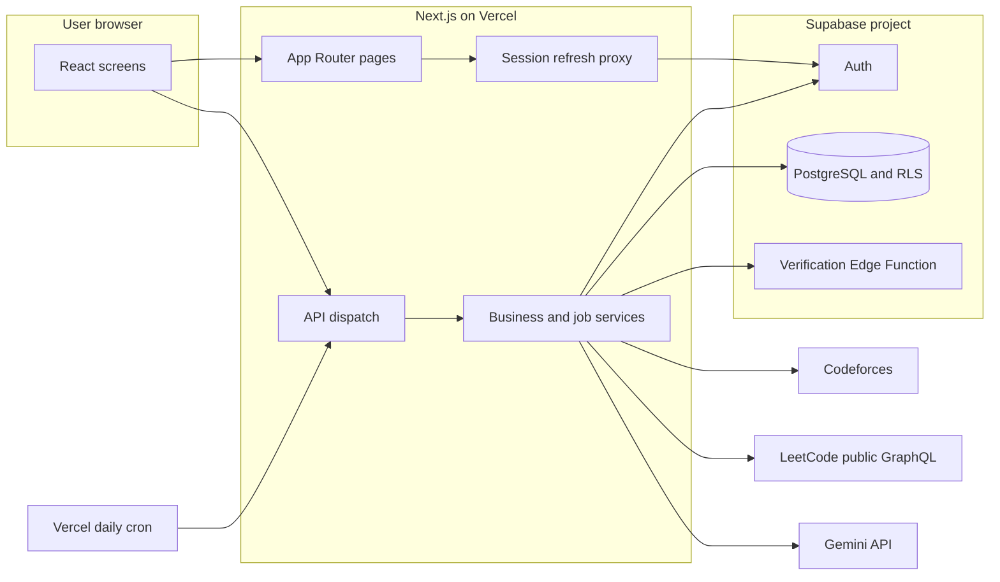
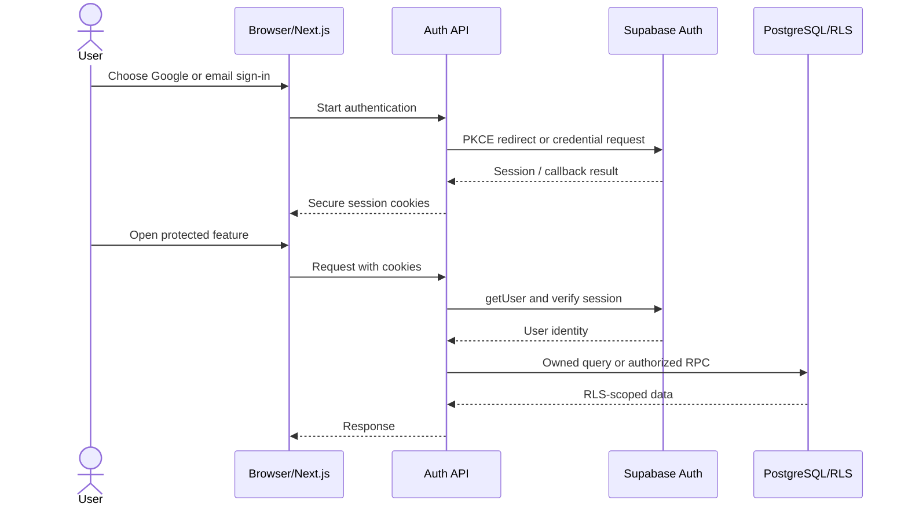
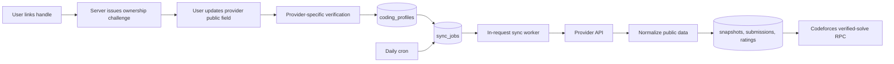
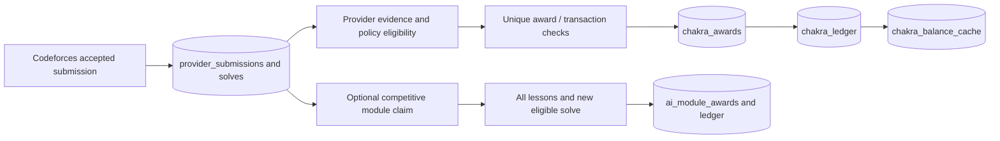
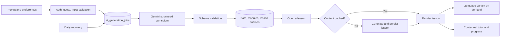
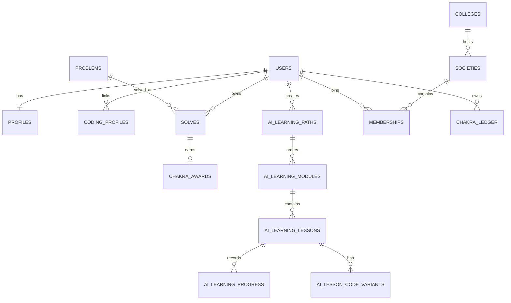

# Architecture

This document describes the checked-in implementation. Proposed changes are identified at the end.

## System boundaries

AlgoGym is a Next.js App Router application hosted on Vercel. Pages under `src/app` render screens from `src/screens` and `src/features`. One catch-all App Router handler dispatches existing API URLs to `server/next-api`, which adapts requests to `server/api-handlers`. Supabase Auth supplies identity and PostgreSQL stores application state. External APIs are called from server code. The browser does not receive Gemini or service-role credentials.

The single API dispatcher is an explicit Vercel Hobby function-count trade-off. Individual handlers retain their own validation and authorization. `src/index.css` is loaded by the root layout; Tailwind and shared UI primitives provide styling. Client session state lives in `AuthContext`; hooks fetch data for screens. There is no separate Redux store.

## Authentication and request flow

`server/api-handlers/auth/google.ts` initiates Supabase Google PKCE OAuth; callback handling establishes cookies. Email/password, confirmation, recovery, and sign-out are also implemented. `src/proxy.ts` refreshes Supabase cookies. Protected handlers call the authenticated user check and enforce resource ownership; service-role access is confined to server modules. Database RLS is a second boundary.

See [authentication](authentication.md) for redirect and authorization details.

## Provider linking and synchronization

Ownership verification and activity synchronization are distinct. The server issues a short-lived, hashed challenge for a canonical handle; a provider-specific public field is checked before linking. Codeforces and LeetCode sync paths then collect different kinds of data. `sync_jobs` is the durable queue, with database RPCs for enqueue/lease and `server/sync-worker.ts` for execution. The daily cron enqueues due profiles and processes a bounded batch; an authorized user request can also start processing through Next.js `after()`.

Codeforces offers rating and accepted-submission evidence. LeetCode synchronization currently stores public aggregates, not individual accepted proofs. Other provider connections do not imply a full submission sync. See [integrations](integrations.md).

## Rewards

Codeforces submission ingestion calls a database award RPC. SQL policies map problem ratings to points, reject duplicates, and update `chakra_awards`, `chakra_ledger`, and `chakra_balance_cache` transactionally. A separate Symm AI competitive-module RPC requires every lesson complete plus a **new eligible verified recommended solve** and has its own uniqueness constraints. Lesson completion alone is not rewarded.

The recent retroactive-award migration changes some historical eligibility. Read [Chakra](chakra.md) and the migration before changing reward code.

## Symm AI

`server/symm-ai.ts` calls Gemini with structured output validation. `server/api-handlers/symm.ts` authenticates, applies quotas, checks path ownership, and persists modules and progress. Curriculum creation returns a roadmap before detailed lessons are generated. `ai_generation_jobs` and events track durable status; `server/symm-jobs.ts` runs or recovers work from requests and the daily cron. Lessons and code variants are cached in PostgreSQL. Tutor calls receive selected course/lesson context and recent conversation history.

These are database-backed jobs executed inside Next.js requests. There is no continuously running worker or streaming queue. See [Symm AI](symm-ai.md).

## Database relationships

The complete schema is migration-defined. Core relationships are summarized here; `auth.users` is managed by Supabase Auth.

Indexes include owner/recent lookups, module and lesson ordering, active-job partial indexes, and uniqueness for solve rewards and memberships. Ownership RLS policies protect AI records; server-side service-role queries repeat ownership checks. See [database](database.md).

## Communities and leaderboards

`colleges`, `societies`, `memberships`, invitations, and applications define community membership. Database functions enforce competitive membership rules and society roles. `server/api-handlers/leaderboards.ts` accepts a validated scope and metric, then calls `read_leaderboard`; ranking eligibility lives in SQL migrations. There is no Redis ranking cache. Snapshots and entries in PostgreSQL support ranking reads.

## Jobs, deployment, and recovery

`vercel.json` invokes `/api/jobs/sync` daily. That endpoint requires `CRON_SECRET`, enqueues due profile syncs, processes a bounded batch, and recovers Symm AI path jobs. User requests can initiate bounded work through Next.js `after()`. Jobs track status and retries in PostgreSQL; uniqueness and lease mechanisms reduce duplicate execution. A serverless invocation can time out, so remaining work depends on later requests or cron. Logs and database job status are the operational evidence; no dedicated worker or Redis is deployed.

## Security boundaries

Browser input is validated in handlers, session identity comes from Supabase Auth, and RLS protects direct database access. `SUPABASE_SERVICE_ROLE_KEY`, `GEMINI_API_KEY`, and `CRON_SECRET` remain server-only. Provider profile fields and generated AI content are untrusted input. The UI renders Markdown through React tooling rather than injecting arbitrary HTML. Provider evidence, not a client click, is required for solve awards.

## Current trade-offs and possible evolution

The one-function API dispatch and request-executed jobs fit the current deployment but constrain concurrency and long generation. A provisioned worker/queue, shorter cron interval, deeper monitoring, and cache could improve throughput after measurement. Redis and an independent authentication service are proposals only. No performance or production scalability benchmark is claimed.
