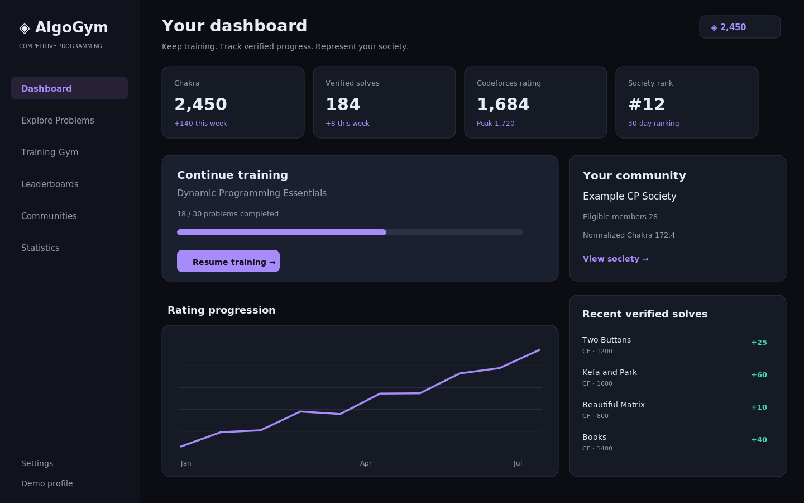
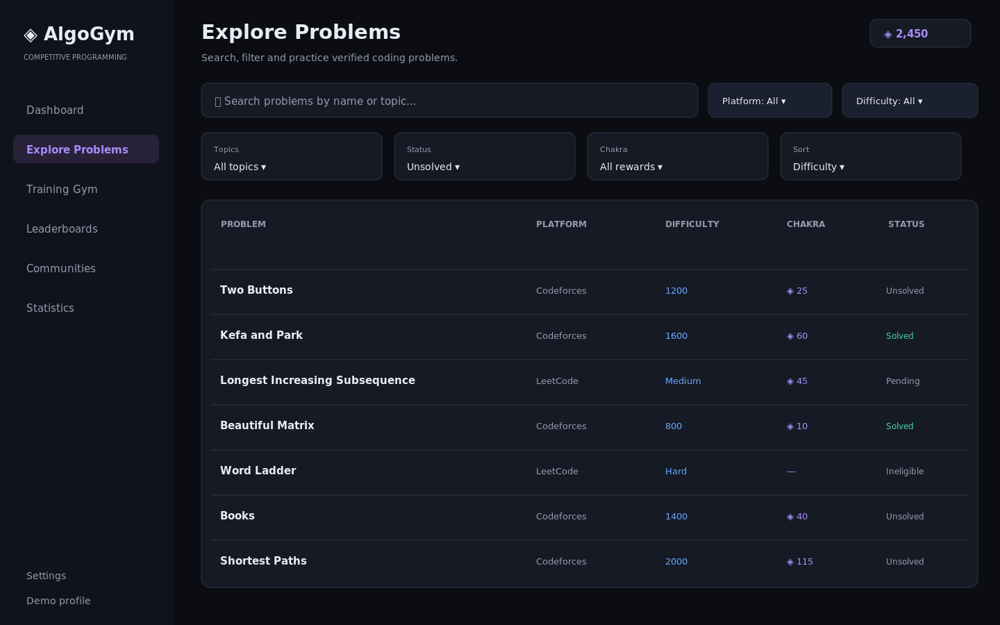
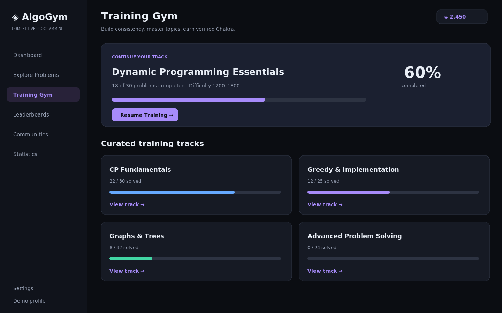
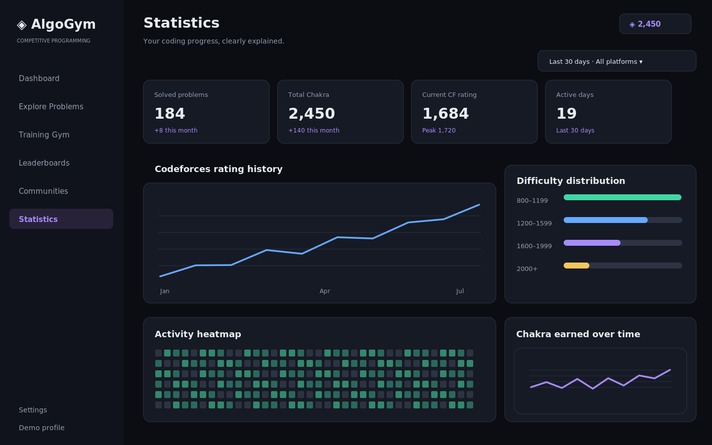

# AlgoGym 2.0 — Unified UI/UX Design Specification & Stitch Prompt Library

> **Version:** 1.0 — 17 October 2026  
> **Audience:** Google Stitch design generation, AI coding CLI, frontend designers/engineers  
> **Companion sources of truth:** `prd.md`, `architecture.md`, `api-and-database-design.md`  
> **Implementation target:** Next.js App Router + TypeScript + Tailwind + shadcn/ui/Radix + Supabase  
> **Priority:** Rework existing AlgoGym, preserve real features/data, do not assume everything must be rebuilt.

## How to use this file

1. Give the full file to your CLI as its UI/UX reference, alongside PRD, architecture, and API/database specifications.
2. For Google Stitch, paste **Prompt 00** first into one project, then each page prompt separately, keeping the same project/style. Use the four images in `assets/` as visual *references*, not exact pixel-perfect requirements.
3. Before frontend implementation, audit existing AlgoGym routes/components and map existing functionality to these screens. Implement with real authorized Supabase data, not screenshots or hardcoded fake metrics.
4. The images are **illustrative, generated layout examples**, with fake sample numbers and names, not screenshots of AlgoGym or proof of deployed features. All layouts, labels and chart data require proper real-state handling.
5. If a PRD requirement conflicts with a speculative visual mockup, **the PRD wins**. If an API/data requirement conflicts with a generated appearance, use the API/database specification.

## The product and design thesis

**AlgoGym is the competitive-programming home for students and college CP societies:** train on Codeforces and LeetCode problems, verify legitimate solves, earn Chakra where eligible, visualize growth, and compete as programmers, societies and colleges. The aesthetic is mature, disciplined, data-rich and supportive of focused practice. Not an anime fan site, not an esports casino, and not a generic SaaS template.

**Five primary UX pillars:** (1) fast problem discovery, (2) structured guided training, (3) accurate personal statistics, (4) credible fair rankings, (5) community identity and administration.

## Design reference pictures (included in this ZIP)

### Dashboard


### Explore Problems


### Training Gym


### Statistics


All pictures are illustrative visual guidance. They deliberately avoid an embedded code editor, fake user-generated social feeds, or features outside the current product brief.

## Prompt 00 — Master design system (paste into Stitch before anything else)

> Design a unified visual identity for **AlgoGym 2.0**, a premium competitive programming and college coding society platform. Create a dark-first, refined, precise, data-focused interface with the product maturity of Linear/Vercel, but a unique AlgoGym identity. Use `#0B0D12` canvas, `#151820` cards, `#252A36` borders, `#E8EDF5` text, `#929BAE` secondary text and `#A78BFA` selectively for Chakra/primary actions. Keep semantically meaningful colors for solved, warning, difficulty, charts. Use generous page-level whitespace but information-dense tables, high-contrast accessible text, careful typography, low-noise borders, 8–12px corner radii, consistent 4/8px spacing rhythm, subtle interaction transitions. Create left desktop app navigation: Dashboard, Explore Problems, Training Gym, Leaderboards, Communities, Statistics; top utility bar: context, global search, Chakra balance, avatar; bottom settings. Mobile uses responsive navigation with priority tasks accessible and no horizontal overflow. Include buttons, search, combo filters, range inputs, badges, tables, skeletons, verified/unverified/pending states, charts, heatmaps, dialogs, empty states, toasts. Build a 1440px desktop shell and 390px mobile shell. No gratuitous gradients, glowing borders, abstract illustrations or copyrighted Naruto imagery. Chakra should be an original understated abstract energy icon. Every future screen MUST reuse this system.

### Global tokens and UX rules

| Token | Value / principle |
|---|---|
| Canvas | `#0B0D12` |
| Sidebar | `#10131B` |
| Elevated surface | `#151820` / `#1B2030` |
| Border | `#252A36` / `#2D3342` |
| Primary text | `#E8EDF5` |
| Secondary text | `#929BAE` |
| Chakra / action accent | `#A78BFA` |
| Verified success | `#42D6A4` |
| Informational blue | `#65A9FF` |
| Warning / highlight | `#F6C65C` |
| Typography | Inter/Geist-like sans-serif; tabular figures for numbers |
| Density | Functional, compact tables; no cramped touch targets |
| Accessibility | AA contrast target, visible keyboard focus, semantic forms, reduced-motion states |

**Global responsive behavior:** Desktop sidebar 240–256px, central max-width content; tablet collapses sidebar; mobile promotes search/filters into drawer, tables become semantic compact rows/cards, charts stack with legible axes. Sticky navigation should not obscure content. Every screen needs loading, error, empty, permissions-denied and slow-sync states as relevant.

**Information integrity:** Don't represent manually ticked training tasks as verified solved problems. Don't treat pending society memberships as active. Don't blend Codeforces and LeetCode ratings. Do not promise LeetCode Chakra if per-submission accepted verification is unavailable. Show timestamps for data sourced from external platforms.

## Canonical routes / screen inventory

| Screen | Proposed route | Main audience |
|---|---|---|
| Public Landing | `/` | Guest |
| Google Sign-in and Onboarding | `/onboarding` | New user |
| Personal Dashboard | `/dashboard` | Programmer |
| Explore Problems | `/problems` | Programmer |
| Problem Detail | `/problems/[id]` | Programmer |
| Training Gym | `/train` | Programmer |
| Training Track | `/train/[id]` | Programmer |
| Statistics | `/statistics` | Programmer |
| Leaderboards | `/leaderboards` | Everyone |
| Communities Directory | `/societies` | Everyone |
| Society Detail | `/societies/[slug]` | Everyone |
| Programmer Profile | `/u/[username]` | Everyone |
| Profile and Settings | `/settings` | Programmer |
| Society Management | `/societies/[slug]/manage` | Society staff |
| Platform Administration | `/admin` | Platform admins |

These are proposed URL patterns; preserve current deep links with redirects when migrating the Vite app.

---

## Prompt 01 — Public Landing

**Route:** `/`

> Create an editorial, conversion-focused public homepage for AlgoGym. Top navigation: brand, Explore Problems, Leaderboards, Communities, Continue with Google. Hero eyebrow "THE COMPETITIVE PROGRAMMING PLATFORM" and headline "Train harder. Climb higher. Represent your college." Supporting copy explains verified Codeforces/LeetCode progress, curated training, Chakra and college societies. Two distinct CTAs: Start Training and Explore Communities. Below: realistic product dashboard preview (not decorative fake UI), four concise core feature modules, an illustrative society ranking with normalized score and qualifying members, a 3-step process "Connect → Practice → Climb", and a final CTA "Make every problem count". Minimal footer. Optimize for visitors understanding value in five seconds. No testimonials, pricing, fictional social proof, animated game heroes, or subscription flow. Show desktop hero and responsive stacked mobile.

**Implementation state checklist:** accessible default, loading/skeleton, empty/new-account, failed fetch/retry, responsive mobile, navigation to relevant next action, proper authorization/visibility.

## Prompt 02 — Google Sign-in & Onboarding

**Route:** `/onboarding`

> Design a four-step focused onboarding flow. Step 1: restrained sign-in modal with **Continue with Google** as the only auth choice. Step 2: Codeforces handle input, validity check, short-lived one-time verification code, Copy button, brief instructions to place code in a public editable profile field, Verify action and expired/mismatch states. Step 3: LeetCode handle/summary-based ownership check with the same UI pattern and explicit "Do this later"; never suggest profile linking by itself guarantees rewards. Step 4: select college, search existing approved society, request membership, create registration application, or skip. Distinguish requested/pending/approved. Show a simple stepper, one primary decision per screen, accessible focus and informative server state. No passwords for external providers and no fake automatic verification.

**Implementation state checklist:** accessible default, loading/skeleton, empty/new-account, failed fetch/retry, responsive mobile, navigation to relevant next action, proper authorization/visibility.

## Prompt 03 — Personal Dashboard

**Route:** `/dashboard`

> Create a daily action dashboard. Greeting + compact verified connected identities. Four KPI cards: earned Chakra, distinct verified solved problems, current Codeforces rating (peak in sublabel), active society rank (or Join Society state). The principal visual/action is **Continue Training** showing current curated track, solved X/Y, progress and Resume CTA. Follow with rating progress line chart, time-window Chakra trend, recent verified solves including source, difficulty, date and reward, compact society snapshot and next suggested practice problems. Use two-column asymmetric analytical layout, not a sea of identical cards. Show disconnected source state and new-user state; mobile should prioritize Continue Training before charts. Picture reference: `assets/01-dashboard-example.png`.

**Implementation state checklist:** accessible default, loading/skeleton, empty/new-account, failed fetch/retry, responsive mobile, navigation to relevant next action, proper authorization/visibility.

## Prompt 04 — Explore Problems

**Route:** `/problems`

> Build a serious fast problem-discovery page. Search by name/topic. Platform segmented selector: All, Codeforces, LeetCode. Combinable filters: numeric Codeforces difficulty/rating range or LeetCode Easy/Medium/Hard, tags (DP, Graphs, Greedy, Math, Binary Search, etc.), status (Unsolved/Solved/Pending), reward bracket and sort. Desktop problem table: title, source, rating/difficulty, tags, Chakra eligible amount, verification state, open action. Status distinguishes independently verified solve from manual activity and unsupported LeetCode submission proof. Visually distinguish ineligible/unknown rewards. Filter chips removable, clear all, pagination/loading/no-results. Mobile list rows and filter drawer. No in-page judge or fake code editor. Picture: `assets/02-explore-problems-example.png`.

**Implementation state checklist:** accessible default, loading/skeleton, empty/new-account, failed fetch/retry, responsive mobile, navigation to relevant next action, proper authorization/visibility.

## Prompt 05 — Problem Detail

**Route:** `/problems/[id]`

> Design an individual problem page. Breadcrumb, title, original provider icon, difficulty, tags, concise permitted summary/description, training collections that include it, problem source link. Primary CTA is **Solve on Codeforces** or **Solve on LeetCode** opening the original source. Separate status panel: not solved, queued provider verification, verified solved, unavailable confirmation. Display Chakra potential only for eligible problems; upon verification display exact awarded points and date, otherwise explanatory disabled/unknown state. Provide permitted Request Sync action, never a self-attested award. Footer/sidebar suggests similar problems. Mobile must immediately reveal source CTA and current status. Do not fabricate an on-site code editor, compiler, submissions judge or official editorial access.

**Implementation state checklist:** accessible default, loading/skeleton, empty/new-account, failed fetch/retry, responsive mobile, navigation to relevant next action, proper authorization/visibility.

## Prompt 06 — Training Gym

**Route:** `/train`

> Flagship structured practice hub distinct from Explore. Title "Training Gym" and helper line "Build consistency. Master fundamentals. Earn Chakra." Current Chakra and verified problem count as secondary context. Strong Continue Your Track card: selected curated track, fraction complete, progress bar, next problem and Resume Training button. Below curated track grid: CP Fundamentals, Greedy & Implementation, Binary Search, Dynamic Programming, Graphs & Trees, Advanced Problem Solving; each track shows problem count, rating range, completion and View Track. A quiet section explains how Codeforces ratings and LeetCode difficulty convert into Chakra, with eligibility footnote. Don't gamify with loot boxes, levels, invented streak multipliers, daily spin or unrelated community feeds. Support first-time user selecting a track and returning user resuming progress. Picture: `assets/03-training-gym-example.png`.

**Implementation state checklist:** accessible default, loading/skeleton, empty/new-account, failed fetch/retry, responsive mobile, navigation to relevant next action, proper authorization/visibility.

## Prompt 06B — Selected Training Track

**Route:** `/train/[id]`

> Design focused training track detail with breadcrumb, title/summary, difficulty band, verified X/Y completion, progress bar and next recommended question. Ordered problems table with number, title, provider, Codeforces rating or LeetCode difficulty, eligible Chakra, verified status, Open Problem CTA. Provide compact chips for unsolved and completed states and an accessible progress legend. Detail view should make the next step unambiguous; do not make it look like an online course video catalog. Add pending sync empty/error states.

**Implementation state checklist:** accessible default, loading/skeleton, empty/new-account, failed fetch/retry, responsive mobile, navigation to relevant next action, proper authorization/visibility.

## Prompt 07 — Advanced Statistics

**Route:** `/statistics`

> Create an unusually well-designed evidence-based programming analytics dashboard. Header has global 7/30/90 days/all time selector, provider selector and last sync timestamp. Six small KPIs: verified solved count, total Chakra, period Chakra, current Codeforces rating, peak Codeforces rating and active practice days. Large Codeforces rating history chart with actual contest tooltip, annotated high, honest no-history state. Separate difficulty distributions: Codeforces by rating bands; LeetCode Easy/Medium/Hard. GitHub-style verified solve heatmap, topic-wise horizontal bars, weekly activity trends, split Chakra time series by source and recent award ledger. Charts clearly label metric, unit, time and provider; never invent a universal rating or combine different rating scales. Show chart skeleton, data gap, stale provider and insufficient-history states. Mobile stacks graphs legibly. Picture: `assets/04-statistics-example.png`.

**Implementation state checklist:** accessible default, loading/skeleton, empty/new-account, failed fetch/retry, responsive mobile, navigation to relevant next action, proper authorization/visibility.

## Prompt 08 — Leaderboards

**Route:** `/leaderboards`

> Design premium competitive rankings with top-level tabs Programmers, CP Societies, Colleges. Filter metric (Chakra, verified solved, Codeforces rating; appropriate provider-specific metrics), period (7d/30d/semester/all), optional college/society scoping. Subtle top-3 band, then scannable rank table with rank, identity, society/college, selected metric, eligible members where relevant, and last updated timestamp. Pin the logged-in user's rank below visible page when needed. Society/college Chakra leaderboard MUST identify normalized eligible-member score rather than raw headcount-dominated total; show sample size and formula tooltip. Include no-qualifying-society case, data freshness and stable paging. Don't mix incompatible ratings, create arbitrary algorithmic "power scores," or award medals for unverified identities.

**Implementation state checklist:** accessible default, loading/skeleton, empty/new-account, failed fetch/retry, responsive mobile, navigation to relevant next action, proper authorization/visibility.

## Prompt 09 — Communities Directory

**Route:** `/societies`

> Design searchable directory of real approved college CP societies. Page heading, explanation, Search by society or college, filters for college/location/verified and sorting by leaderboard rank/active member count. Each card/list row: logo, society name, college, approval badge, eligible member count, normalized Chakra rank or "Not ranked yet", brief recent activity and View Community CTA. If visitor is signed in and already a member, show discrete Your Community shortcut. Prominent but secondary Register Your CP Society route, clearly labeled as requiring approval. Empty search, pending registration, no matching college and loading states. This is not a Discord clone: no public chat, social feed or events/calendar added.

**Implementation state checklist:** accessible default, loading/skeleton, empty/new-account, failed fetch/retry, responsive mobile, navigation to relevant next action, proper authorization/visibility.

## Prompt 10 — Society Profile

**Route:** `/societies/[slug]`

> Create public home for approved society. Identity header with logo, society name, college, approval status, intro and contextual CTA Request to Join / Request Pending / View My Society Progress. Tabs Overview, Members, Leaderboard, Statistics. First view metrics: active eligible members, normalized Chakra rank, average eligible Codeforces rating, 30-day Chakra per eligible member. Show participation rate, recent aggregate verified solves, date-chart, member roster (respect visibility), internal member rankings switchable by Chakra/rating/solves and aggregated topic/difficulty. Society admin gets understated Manage link. Explain qualification rules and current data timestamp. Include newly approved zero-member state.

**Implementation state checklist:** accessible default, loading/skeleton, empty/new-account, failed fetch/retry, responsive mobile, navigation to relevant next action, proper authorization/visibility.

## Prompt 11 — Programmer Profile

**Route:** `/u/[username]`

> Design polished programmer portfolio: avatar, display name and handle, short bio, college/society, connected Codeforces and LeetCode handles with distinct verified statuses, without fake follower counts. KPIs: Chakra, verified solves, current CF rating, peak CF rating, eligible society rank. Tabs Overview, Statistics, Solved Problems, Chakra History. Overview: rating history, activity heatmap, practice topic breakdown and recent verified activity. Solved page table: title/source/difficulty/solve date/award if any. History: append-only reward entries and visually distinct approved reversals. Personal profile shows Edit Profile; public profile respects opt-in visibility/hidden data. Don't fabricate endorsements, certification or AI assessment.

**Implementation state checklist:** accessible default, loading/skeleton, empty/new-account, failed fetch/retry, responsive mobile, navigation to relevant next action, proper authorization/visibility.

## Prompt 12 — Settings & Connected Accounts

**Route:** `/settings`

> Build simple settings sections: Profile, Connected Accounts, Community Membership, Privacy. Profile: avatar, display name, username and optional bio. Connected Accounts: Google as actual sign-in provider; Codeforces and LeetCode handle cards with verification state, last sync, retry/verify/unlink actions. Account linking modal shows code generation, Copy button, exact provider settings instructions, verifying, invalid, expired and successful states without ever asking for coding-platform credentials. Community: college/society membership, role/status, request/leave flow with effect on future society scoring explained. Privacy: supported visibility controls only. Save success and destructive confirmations. No invented billing, subscriptions or notification settings.

**Implementation state checklist:** accessible default, loading/skeleton, empty/new-account, failed fetch/retry, responsive mobile, navigation to relevant next action, proper authorization/visibility.

## Prompt 13 — Society Management

**Route:** `/societies/[slug]/manage`

> Private operations dashboard for approved society admin/moderator. Overview metrics: eligible and active members, pending join requests, society rank, avg qualifying rating. Pending application queue shows applicant name, verified handles, college context, submitted date and Approve/Reject with confirmation. Searchable members table includes role, membership status, joined date, rating, Chakra, verified activity and permission-appropriate actions. Graphs for participation, difficulty/topic and cumulative performance. Edit approved society public details and logo. Distinguish Admin versus Moderator permissions and normal member forbidden state. Clear duplicate-membership conflict, newly created society and no pending requests views.

**Implementation state checklist:** accessible default, loading/skeleton, empty/new-account, failed fetch/retry, responsive mobile, navigation to relevant next action, proper authorization/visibility.

## Prompt 14 — Platform Super Admin

**Route:** `/admin`

> Restricted admin console for platform staff, distinct from student/society UI but sharing tokens. Navigation Overview, Society Applications, Account Disputes, Integration Health, Chakra Corrections, Audit Logs. Overview flags pending reviews, identity disputes, provider sync failures and stale ranking generations. Society application review contains verified college claim, applicant, evidence-access status and Approve/Reject/Request Information action. Account disputes avoid exposing code tokens. Integration status shows Codeforces/LeetCode ingestion freshness, pending jobs and failures (no invented live readings). Chakra correction is a controlled reversal dialog requiring specific award and reason, never a general free-form Add Points tool. Audit log shows actor/action/resource/time, searchable and permission-controlled. Emphasize operational density and clear authorized decisions.

**Implementation state checklist:** accessible default, loading/skeleton, empty/new-account, failed fetch/retry, responsive mobile, navigation to relevant next action, proper authorization/visibility.

---

## Chakra point-system rules: never diverge between design and implementation

| Codeforces problem rating | Chakra |
|---|---:|
| 800–999 | 10 |
| 1000–1199 | 15 |
| 1200–1399 | 25 |
| 1400–1599 | 40 |
| 1600–1799 | 60 |
| 1800–1999 | 85 |
| 2000–2199 | 115 |
| 2200–2399 | 150 |
| 2400–2599 | 190 |
| 2600–2799 | 240 |
| 2800–2999 | 300 |
| 3000–3199 | 375 |
| 3200–3399 | 475 |
| 3400–3500 | 600 |

| LeetCode difficulty | Chakra |
|---|---:|
| Easy | 15 |
| Medium | 45 |
| Hard | 110 |

**Eligibility:** Codeforces uses *problem rating*, not the solver's rating. Unrated / outside bracket returns no v1 reward unless a future approved policy defines it. LeetCode rewards remain gated until accepted individual solves can be reliably verified; do not present hypothetical awards as credited balance. Unique `(user, provider, problem)` yields one initial award under versioned rules. Server award ledger is authoritative; retries must not duplicate credits. Existing historical solves may require explicit backfill policy. Period and team aggregation follows the PRD.

## UI components and interaction specifications

| Reusable component | Behaviors and states |
|---|---|
| `AppShell` | Persistent navigation, contextual title, Chakra account badge, breakpoint variants |
| `PageHeading` | title, short subtitle, contextual actions |
| `StatCard` | typed metric, proper unit, source, freshness, comparison only if available |
| `ChakraBadge` | eligibility, potential vs earned vs unavailable |
| `ProblemRow` | provider icon, difficulty, tags, award, verified status, source action |
| `FilterBar` | combined filters, applied chips, clear/reset, URL query sync |
| `VerificationCard` | handle input, challenge display, link to settings, pending/verified/expired/error |
| `RatingChart` | Codeforces-only ratings, date range, high, empty and loading |
| `ContributionHeatmap` | actual verified activity, accessible table alternative |
| `LeaderboardTable` | category/metric/window, ties, rank, source and scoring method |
| `CommunityIdentity` | approved state, college, members, rank or unranked |
| `MemberTable` | privacy-conscious roster, sort/search, staff actions only |
| `AdminReviewPanel` | permission-controlled approve/reject, evidence, confirmation and audit feedback |
| `SyncStatus` | queued, updating, recently updated, stale, error |
| `EmptyState` | explanation and one useful next step, never decorative filler |

### Interaction and accessibility

- All links/buttons must have accessible labels and predictable outcomes. Keyboard can reach sidebar, filters, dialogs and tables. Focus returns correctly after modal close.
- Use labels and units alongside colors; don't convey solved/difficulty with color alone.
- All compact touch targets must meet practical touch size. Avoid hover-only interactions on mobile.
- Charts must have explicit time and metric, accessible summarizing text and readable tooltips.
- Avoid animation in metrics that might misleadingly imply current updates; support reduced motion.
- Validate forms inline. Distinguish business conflicts from network errors and provider rate limiting.
- Every API-backed card shows stale/unavailable states rather than inventing numbers.
- Do not leak private membership evidence, email, token digests, audit logs or provider secrets in UI.

## Responsive layouts

- **Desktop (1440px reference):** 240–256px sidebar; max readable main width, balanced 12-column page grid; two-column chart panels; compact data rows.
- **Tablet (~768–1023px):** Collapsible sidebar and chart grids, flexible table density, full-width forms.
- **Mobile (390px reference):** No horizontal page scrolling; fixed/sticky mobile navigation used sparingly; problem tables become list rows, filters become sheets, primary CTA visible early, charts are vertically stacked with adequately sized labels.

## Design-to-code handoff / CLI contract

Use this alongside the other three project documents. The UI/UX file describes **presentation and behavior only**; it does not override backend invariants, migration guidance, authentication rules or API contracts. Implement in Next.js App Router with TypeScript and Tailwind/shadcn, using actual Supabase Auth and controlled server routes. Prefer an audited incremental migration from Vite React and reuse validated existing training flows. Never infer a database schema from the mockup image. Build reusable components and typed view models, not one-off 14 monolithic pages.

**Recommended implementation sequence:** AppShell + tokens → dashboard and problem list → problem detail/training → statistics → leaderboards → society directory/profile → account linking → society management/admin → public landing polish. Add tests for responsive nav, filter URLs, permissions, states, Chakra labels and link destinations.

### Copy-paste CLI implementation prompt

```text
You are implementing the AlgoGym 2.0 UI/UX redesign. Read ui-ux.md fully, then prd.md, architecture.md and api-and-database-design.md, before touching code. Inspect the existing repository, current routes, reusable components, assets, Supabase schema and authorization. The target stack is Next.js App Router + TypeScript + Tailwind/shadcn/Radix + Supabase; plan an additive migration, preserving user data and functional features. Use assets/*.png only as visual references, not as site content or hardcoded UI.

First document route migration and shared design tokens. Then implement the shared responsive app shell and reusable components. Implement each page in the order prescribed by ui-ux.md, preserving feature scope and using real typed API/Supabase data. Do not manufacture verified status, Chakra, society approvals, ratings or LeetCode submission evidence. Handle loading, empty, partial, stale, error and mobile states. Enforce accessible keyboard interactions and appropriate role-based navigation. Reuse existing logical flows where correct; avoid unrelated features such as on-site code execution, general social feeds, payments or gamification extras.

Before reporting complete: run typecheck, lint, relevant tests and production build; visually review at desktop and 390px mobile; document remaining blockers and provider-data limitations. Do not change production Supabase schema without explicit migration review and backup.
```

### Stitch consistency refinement prompt

> Across all AlgoGym 2.0 screens in this project, unify sidebar, mobile navigation, typography, spacing, controls, buttons, filters, metric cards, Chakra identity, color meaning, verification statuses and table density. Remove unnecessary decorative gradients, repeated cards and generic dashboard filler. Make Explore Problems a discovery engine and Training Gym a guided practice experience. Ensure society rankings explicitly disclose normalized eligible-member metrics, and stats distinguish provider-specific values. Check all desktop/mobile states, focus, loading, errors, overflow and chart labels. Do not add features outside the requirements. Result: polished, consistent, calm, production-quality developer interface.

## Design acceptance checklist

- [ ] Same typography, spacing and visual tokens across every route
- [ ] Sidebar/mobile nav is responsive, keyboard accessible and respects role permissions
- [ ] Explore Problems and Training Gym are clearly different workflows
- [ ] All score values and Chakra labels conform to actual scoring policy and eligibility
- [ ] Verified solved, pending sync and unverified user actions are visually distinct
- [ ] Society and college leaderboard ranking methodology is visible and normalized
- [ ] Codeforces/LeetCode statistics never blend incompatible rating values
- [ ] Onboarding uses Google and reliable ownership verification, not coding platform passwords
- [ ] Supabase-backed empty/loading/error/permission states are designed everywhere
- [ ] Screens are legible at 1440px desktop and 390px mobile without content overlap
- [ ] Public profile/membership visibility is privacy-conscious
- [ ] No unsupported payments, chat feeds, in-browser judge, loot boxes or fabricated AI features

**End of document.**
